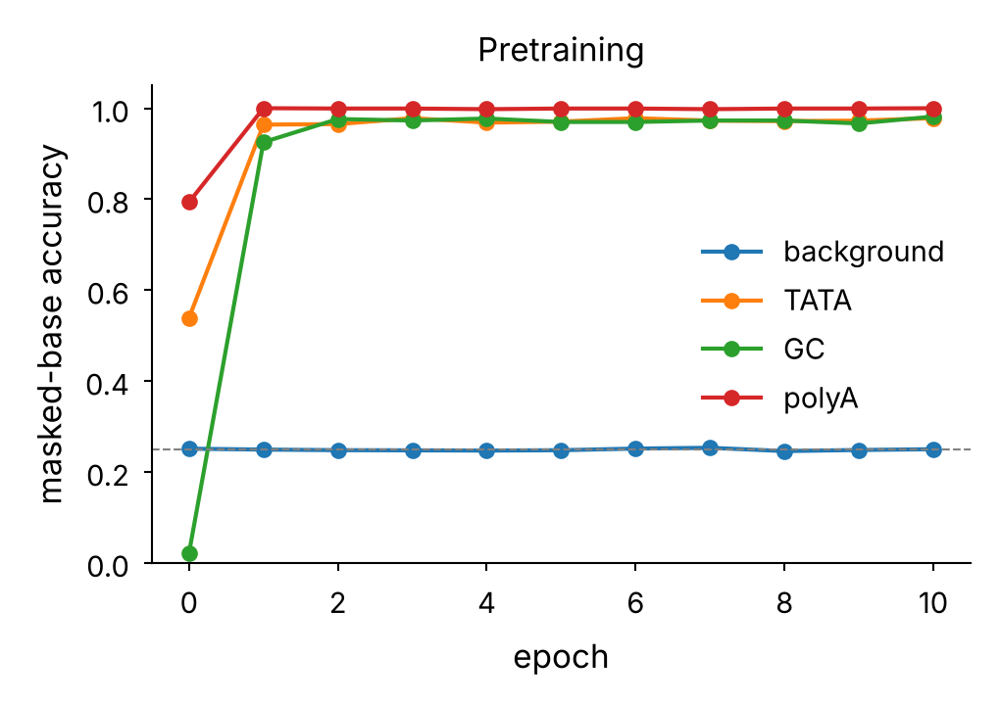
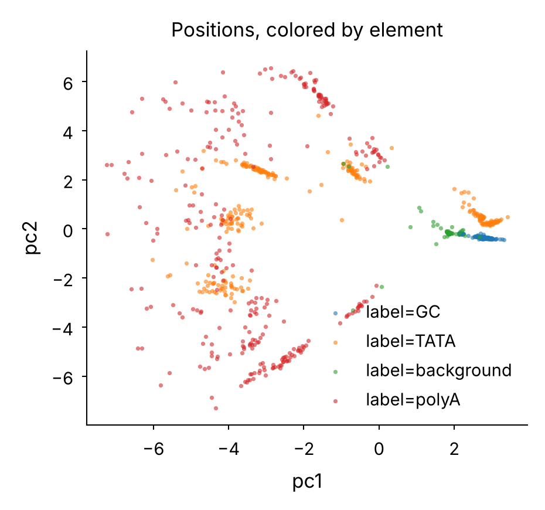

# Embeddings and self-supervised pretraining

## Learning goals

After this module you should be able to

1. Explain what an embedding is and how it differs from one-hot encoding.
2. Describe masked prediction as a way to train a model without labels.
3. Interpret what a pretrained model's representations do and do not capture.

## Introduction

Every model so far was trained with labels. Labels are expensive. Someone has
to run the assay, annotate the recording, or classify the variant. Unlabeled
data are cheap. There are billions of genome bases and millions of hours of
field recordings that nobody has labeled.

Self-supervised pretraining gets a training signal out of unlabeled data by
hiding part of each example and asking the model to predict it. To fill in a
hidden base, the model has to learn which patterns are common in the genome.
That knowledge ends up in the model's internal representations, its
embeddings, which later lectures reuse for tasks that do have labels.

This is how ESM (proteins), GPN and Nucleotide Transformer (DNA), and AVES
(animal vocalizations) are built.

## Embeddings

In the convolution lecture each base was one-hot encoded, A as `1 0 0 0`, C as
`0 1 0 0`, and so on. One-hot vectors are fixed. Every base is the same
distance from every other base, and the encoding carries no information beyond
which base it is.

An embedding replaces the fixed vector with a learned one. The model keeps a
table with one row per token, here the four bases plus a mask token, and each
row is a vector of 8 numbers. The numbers are parameters, updated by gradient
descent like any weight. Looking up a token's row is the same as multiplying
its one-hot vector by the table, so an embedding is a linear layer applied to
one-hot input.

With only five tokens there is not much for the table to learn. After
pretraining, the five rows are about equally far apart.

<details>

```bash
python src/show_embedding.py --model out/pretrained.pt
token   dim0   dim1   dim2   dim3   dim4   dim5   dim6   dim7
A      -0.59  -1.20  -0.28  -0.37   0.54   0.49  -0.32  -2.07
C       0.74  -1.84   0.57   0.99   0.16   1.55   1.30   0.08
G      -1.27  -1.78   0.56   1.00   0.64  -1.23  -0.42   1.93
T       0.49  -1.05   0.70   0.30  -0.75  -0.88   1.46   0.29
mask    1.05  -0.18  -1.05   0.09  -0.34  -0.13  -1.39   1.57

distance between token vectors
          A     C     G     T  mask
A      0.00  3.64  4.73  3.86  4.48
C      3.64  0.00  4.29  2.83  4.34
G      4.73  4.29  0.00  3.53  3.82
T      3.86  2.83  3.53  0.00  3.82
mask   4.48  4.34  3.82  3.82  0.00
```

</details>

Token embeddings become more interesting with more tokens. Protein language
models embed 20 amino acids, and Rives et al. (2021) found that hydrophobic,
aromatic, and charged amino acids end up in separate groups without being
told about chemistry. The more important embeddings are the ones a model
computes for each position after reading its context. Those are what we look
at below.

## Data

We generate 20,000 unlabeled sequences of 100 bp. Each is random background
with up to three kinds of planted element, each present in about half the
sequences.

| Element | Sequence | Function |
|-|-|-|
| TATA box   | `TATAAA`     | raises expression |
| GC box     | `GGGCGG`     | raises expression |
| poly-A run | `AAAAAAAAAA` | none |

The file also records each sequence's expression, but pretraining never sees
it. The poly-A run is there on purpose. It is common and easy to recognize,
and it does nothing.

<details>

```bash
python src/make_genome.py \
    --n 20000 \
    --out out/genome.tsv
wrote out/genome.tsv: 20000 sequences of 100 bp
  TATA   TATAAA       in 50.0% of sequences
  GC     GGGCGG       in 50.3% of sequences
  polyA  AAAAAAAAAA   in 49.5% of sequences

head -3 out/genome.tsv
id	seq	expression	elements
seq00000	TGGCCAAAATGTGGTGGGGTCTGACTGATGTAATAGACCCCAAAAGGGCGTCCTTTCGTGTAAAAAAAAAACCCGGGGCGGGCCGGGCTCCTCAGGAACT	2.1185	GC:75,polyA:61
seq00001	CTCTTGATAGCTATAGGTCTGTATTACGAGGTTCCCTACACTGCTGTACTTTATAAAACCGGGTTAAAGTTGTTAAAAAAAAAATCTCTACCATTATTCC	2.3250	TATA:51,polyA:74
```

</details>

## Masked prediction

### Model

The model has three parts.

1. Embedding. Each base becomes a vector of 8 learned numbers.
2. Two convolution layers, each with 64 kernels 9 bases wide and a ReLU. After
   both layers, each position's 64 numbers depend on the 17 bases around it.
   These 64 numbers are the position's contextual embedding.
3. An output layer that turns each position's 64 numbers into 4 scores, one
   per base.

That is 41,900 parameters.

### Training

Each time a sequence is used, a random 15% of its bases are replaced with the
mask token. The model predicts the four bases at every position, and the loss
counts only the masked positions. The correct answer is the base that was
hidden, so no labels are needed.

The loss is cross-entropy, the four-class version of binary cross-entropy. The
four scores at a position go through softmax, which turns them into four
probabilities that add to 1.

$$P(\text{base } k) = \frac{e^{z_k}}{\sum_{j} e^{z_j}}$$

The loss is $-\log P(\text{true base})$, the same idea as BCE. It is 0 when
the model puts all its probability on the right base and grows without bound
as that probability goes to 0. A model that always guesses 25% for each base
has a loss of $\log 4 = 1.386$.

We hold out 2,000 sequences and, after each epoch, measure how often the model
fills in a hidden base correctly, separately for bases in background and in
each element.



After one epoch the model fills in hidden bases in all three elements more than
92% of the time. In background it stays at 25%, chance for four bases,
because background bases are random and there is nothing to learn. The overall
loss only drops to 1.283, not far below 1.386, because 85% of bases are
background.

<details>

```bash
python src/pretrain.py \
    --genome out/genome.tsv \
    --epochs 10 \
    --log out/pretrain.log.tsv \
    --out out/pretrained.pt
18000 training and 2000 validation sequences, 41900 parameters
epoch 00 loss=nan masked acc: all=0.279 background=0.251 TATA=0.539 GC=0.022 polyA=0.793  (0s)
epoch 01 loss=1.3248 masked acc: all=0.328 background=0.249 TATA=0.964 GC=0.925 polyA=1.000  (4s)
epoch 02 loss=1.2944 masked acc: all=0.328 background=0.248 TATA=0.965 GC=0.976 polyA=0.999  (7s)
epoch 03 loss=1.2885 masked acc: all=0.328 background=0.247 TATA=0.978 GC=0.973 polyA=0.999  (11s)
epoch 04 loss=1.2875 masked acc: all=0.327 background=0.247 TATA=0.968 GC=0.977 polyA=0.998  (14s)
epoch 05 loss=1.2882 masked acc: all=0.328 background=0.248 TATA=0.970 GC=0.970 polyA=0.999  (18s)
epoch 06 loss=1.2875 masked acc: all=0.331 background=0.251 TATA=0.978 GC=0.970 polyA=0.999  (21s)
epoch 07 loss=1.2854 masked acc: all=0.333 background=0.253 TATA=0.973 GC=0.973 polyA=0.998  (25s)
epoch 08 loss=1.2856 masked acc: all=0.326 background=0.246 TATA=0.972 GC=0.973 polyA=0.999  (28s)
epoch 09 loss=1.2842 masked acc: all=0.328 background=0.248 TATA=0.973 GC=0.966 polyA=0.999  (32s)
epoch 10 loss=1.2833 masked acc: all=0.331 background=0.250 TATA=0.978 GC=0.982 polyA=1.000  (35s)
wrote out/pretrained.pt

python src/plot_tsv.py \
    -i out/pretrain.log.tsv \
    -x epoch \
    -y background,TATA,GC,polyA \
    --kind linepoint \
    --ylabel "masked-base accuracy" \
    --title "Pretraining" \
    --hline 0.25 \
    --y_min 0 \
    --y_max 1.05 \
    -o img/pretrain.acc.png
```

</details>

## What the representations learned

We run held-out sequences through the pretrained model, without masking, and
collect the 64-number contextual embedding at each position. To look at 64
dimensions we use principal component analysis (PCA), which finds the two
directions along which the vectors vary the most. We take 300 positions from
background and 300 from each element.



Without ever seeing a label, the model represents the positions inside each
element differently from background and from each other. Background positions
collapse into one tight cluster, because the model has learned that nothing
about them is predictable.

This is the sense in which pretraining "learns biology." It is easy to read too
much into it. The model separates the poly-A run as cleanly as the TATA box.
It learned what is common and predictable in the sequences, and the poly-A
run is the most predictable thing in them. Nothing in the training objective
says anything about function. The next module shows where that matters.

<details>

```bash
python src/embed.py \
    --model out/pretrained.pt \
    --genome out/genome.tsv \
    --level position \
    -o out/pos.pca.tsv
1200 position vectors of length 64
PC1 explains 24.6% of the variance, PC2 15.9%

python src/plot_tsv.py \
    -i out/pos.pca.tsv \
    -x pc1 \
    -y pc2 \
    --group label \
    --kind scatter \
    --point_size 3 \
    --alpha 0.6 \
    --ylabel pc2 \
    --title "Positions, colored by element" \
    --width 3.2 \
    --height 3 \
    -o img/pos.pca.png
```

</details>

The 1,200 positions come from the first 500 sequences in the file, which were
among the 2,000 held out from pretraining.

# Questions

1. Pretrain with `--n_train 500` instead of all 20,000 sequences. How does the
   masked-base accuracy in each element change? How much unlabeled data does a
   model need to find a 6 bp motif that is in half the sequences?

   ```bash
   python src/pretrain.py \
       --genome out/genome.tsv \
       --n_train 500 \
       --epochs 10 \
       --out out/pretrained_500.pt
   ```

2. Pretrain with `--kernel 3`. Each position now sees only 5 bases of
   context after two layers. Which element suffers most? Why?

3. Run `embed.py --level sequence`, which averages the position embeddings over
   each sequence. Color the PCA plot by element. Which element separates the
   sequences most? Is it the one that matters for expression?

   ```bash
   python src/embed.py \
       --model out/pretrained.pt \
       --genome out/genome.tsv \
       --level sequence \
       -o out/seq.pca.tsv
   python src/plot_tsv.py -i out/seq.pca.tsv -x pc1 -y pc2 \
       --group label --kind scatter --point_size 3 -o img/seq.pca.png
   ```

4. In AVES (Hagiwara 2023) the masked units are short pieces of audio rather
   than bases. What would play the role of the poly-A run in field recordings?

## Reading

- Sainburg, Thielk and Gentner 2020. Finding, visualizing, and quantifying latent structure across diverse animal vocal repertoires. *PLoS Computational Biology* 16(10):e1008228. Learned embedding spaces across 29 species.
- Hagiwara 2023. AVES: Animal Vocalization Encoder based on Self-Supervision. *ICASSP 2023*. Self-supervised pretraining for bioacoustics.
- Rives et al. 2021. Biological structure and function emerge from scaling unsupervised learning to 250 million protein sequences. *PNAS* 118:e2016239118. Structure appearing in a learned embedding.
