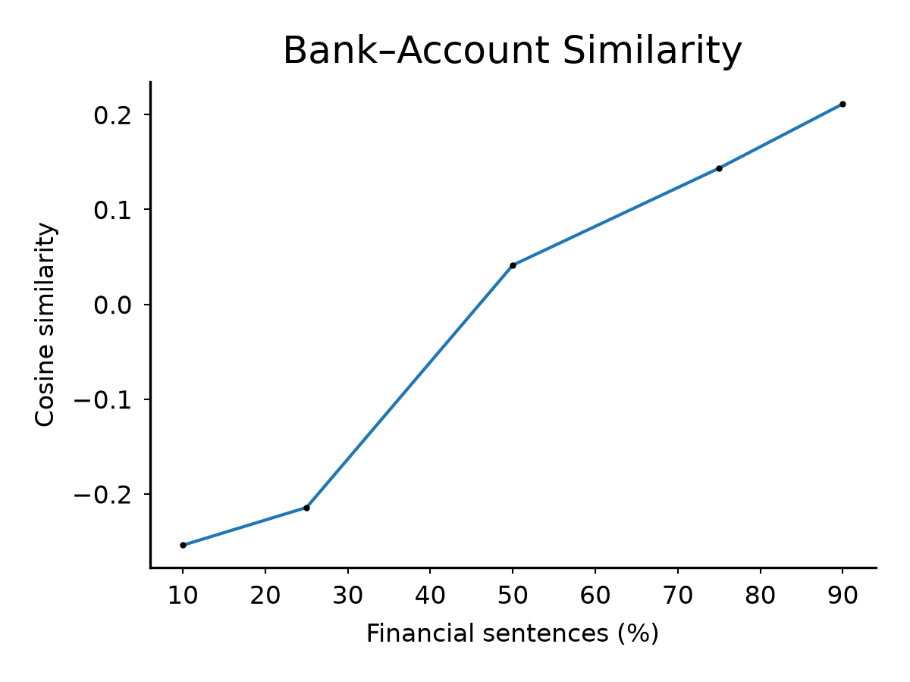
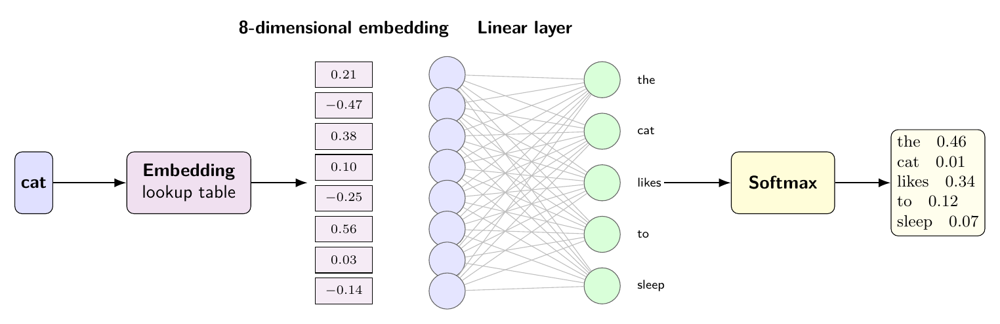

# Masked prediction and contextual embeddings

## Learning goals

After this module you should be able to

1. Explain how masked prediction allows models to learn from sequences without externally supplied labels.
2. Describe how convolutional neural networks learn contextual representations of DNA sequences.
3. Evaluate whether a model's ability to predict sequence patterns provides evidence that those patterns are biologically functional.

## Introduction

Word2vec learns embeddings by training a model to predict surrounding words.
Words that appear in similar contexts can end up with similar embeddings,
allowing models to use what they learn about one word to make predictions about
other words with similar meanings or relationships.

This becomes more complicated when a word has multiple meanings and appears in
different contexts. Since word2vec learns just one embedding for each word,
that embedding is updated based on all the contexts in which the word appears.
For example, `bank` has the same embedding whether it refers to a financial
institution or the side of a river. During training, the embedding is adjusted
based on both contexts, which can pull it away from words associated with
either meaning, such as `account` or `shore`.  As a result, words that are
related in one context may have less similar embeddings, limiting the model's
ability to transfer what it learns between related words. 

To examine this effect, we generated a set of 5,000 sentences that used `bank`
as a financial institution and another set as the side of a river. We then
trained word2vec on 5,000 sentences containing different proportions of these
two contexts and measured the cosine similarity between `bank` and `account` or
`shore`.

For example, when word2vec was trained on just financial sentences, `bank` and
`account` had a cosine similarity of 0.31. When the training data were changed
to a 75/25 mix of financial and river sentences, their similarity dropped to
0.12.

We also trained models with financial sentences making up 10%, 25%, 50%, 75%,
and 90% of the training data. As the proportion of financial sentences
increased, the similarity between `bank` and `account` increased from -0.25 to
0.21, while its similarity to `shore` decreased from 0.96 to 0.25.

| Bank–Account Similarity | Bank–Shore Similarity |
|-|-|
|  |  |

These results show how different contexts influence a word's embedding. Because
word2vec learns only one embedding per word, the representation must
accommodate both meanings, potentially reducing its similarity to words
associated with either one.

<details>

```
python src/word2vec_train.py \
    --data data/bank_financial.txt \
    --dim 8 \
    --window 2 \
    --epochs 12 \
    --out out/bank_financial
5000 sentences, 32 words, 86000 training pairs
epoch 01 loss=2.6760
epoch 02 loss=2.0417
epoch 03 loss=1.8876
epoch 04 loss=1.8435
epoch 05 loss=1.8303
epoch 06 loss=1.8241
epoch 07 loss=1.8213
epoch 08 loss=1.8195
epoch 09 loss=1.8182
epoch 10 loss=1.8169
epoch 11 loss=1.8167
epoch 12 loss=1.8163
Wrote results to out/bank_financial

cat out/bank_financial/embedding_history.tsv \
| csvgrep -t -c epoch -r "^12$"\
| csvgrep -c word -r "(bank|account)" \
| csvcut -C epoch,word \
| csvformat -T \
| tail -n +2 \
| python src/cosine_similarity.py
0.3137951213590353

(cat data/bank_financial.txt | shuf | head -n 3750 ; 
cat data/bank_river.txt | shuf | head -n 1250) \
| shuf \
> out/bank_mixed_75.txt

python src/word2vec_train.py \
    --data out/bank_mixed_75.txt \
    --dim 8 \
    --window 2 \
    --epochs 12 \
    --out out/bank_mixed_75
5000 sentences, 59 words, 86924 training pairs
epoch 01 loss=3.2241
epoch 02 loss=2.4592
epoch 03 loss=2.2334
epoch 04 loss=2.1396
epoch 05 loss=2.0955
epoch 06 loss=2.0722
epoch 07 loss=2.0580
epoch 08 loss=2.0476
epoch 09 loss=2.0410
epoch 10 loss=2.0362
epoch 11 loss=2.0326
epoch 12 loss=2.0297
Wrote results to out/bank_mixed_75

cat out/bank_mixed_75/embedding_history.tsv \
| csvgrep -t -c epoch -r "^12$"\
| csvgrep -c word -r "(bank|account)" \
| csvcut -C epoch,word \
| csvformat -T \
| tail -n +2 \
| python src/cosine_similarity.py
0.11544264722774267

echo -e "financial_pct\tword\tcosine_similarity" > out/bank_similarity.tsv

for pct in 10 25 50 75 90; do
    financial=$((pct * 50))
    river=$((5000 - financial))

    (shuf -n "$financial" data/bank_financial.txt
     shuf -n "$river" data/bank_river.txt) \
        | shuf > out/bank_mixed_${pct}.txt

    python src/word2vec_train.py \
        --data out/bank_mixed_${pct}.txt \
        --dim 8 \
        --window 2 \
        --epochs 12 \
        --out out/bank_mixed_${pct}

    for word in account shore; do
        similarity=$(
            cat out/bank_mixed_${pct}/embedding_history.tsv \
                | csvgrep -t -c epoch -r "^12$" \
                | csvgrep -c word -r "^(bank|${word})$" \
                | csvcut -C epoch,word \
                | csvformat -T \
                | tail -n +2 \
                | python src/cosine_similarity.py
        )

        printf "%s\t%s\t%s\n" \
            "$pct" "$word" "$similarity" \
            >> out/bank_similarity.tsv
    done
done

cat out/bank_similarity.tsv \
| csvgrep -t -c word -m account \
| csvcut -c financial_pct,cosine_similarity \
| csvformat -T \
| tail -n +2 \
| python src/plot_line.py \
    -o img/bank_account.png \
    --line_style "o-" \
    -x "Financial sentences (%)" \
    -y "Cosine similarity" \
    -t "Bank–Account Similarity"

cat out/bank_similarity.tsv \
| csvgrep -t -c word -m shore \
| csvcut -c financial_pct,cosine_similarity \
| csvformat -T \
| tail -n +2 \
| python src/plot_line.py \
    -o img/bank_shore.png \
    --line_style "o-" \
    -x "Financial sentences (%)" \
    -y "Cosine similarity" \
    -t "Bank–Shore Similarity"
```

<details>

## Contextual embeddings

Contextual embeddings address this limitation by using the surrounding words to
calculate an embedding each time a word appears. Consider two sentences:
- `She deposited money in the bank.`
- `The fisherman sat on the bank of the river.`

In word2vec, `bank` has the same embedding in both sentences because the model
looks up its values in a table. In a contextual model, the surrounding words
are used to calculate a different embedding for each occurrence. Words like
`deposited` and `money` help the model represent `bank` as a financial
institution, while `fisherman` and `river` help it represent the side of a
river.  As a result, the embedding for `bank` can be more similar to `account`
in the first sentence and to `shore` in the second.

Contextual embeddings are particularly important for DNA, where the effect of a
sequence can depend on the surrounding bases. The same DNA sequence might have
different roles depending on where it appears and which other sequence elements
are nearby.

In this module, we will train a model to predict missing bases in DNA sequences
using information from the surrounding bases. The correct answers come directly
from the sequences, making this another example of self-supervised learning. We
will then examine the contextual embeddings the model learns and whether they
capture biologically meaningful patterns.

## Data

We will generate randomly DNA sequences containing one of three different
patterns inserted at a random position.

| Pattern    | Example    |
|-|-|
| TATA box   | `TATAAA`   |
| GC box     | `GGGCGG`   |
| Poly-A run | `AAAAAAAA` |

These patterns occur in real genomes, but their presence alone does not
establish biological function. In our synthetic dataset, none of the patterns
has an assigned biological role. They are simply sequences that occur more
frequently than expected by chance.

The goal is to determine whether a model trained to predict missing DNA bases
can learn these sequence patterns and represent them differently from random
background DNA. We can then examine whether learning predictable patterns tells
us anything about their biological importance.

<details>

```bash
python src/make_genome.py \
    --n 10000 \
    --length 200 \
    --out out/synthetic_genome
wrote out/synthetic_genome: 10000 sequences of 200 bp
  TATA   TATAAA       in 50.2% of sequences
  GC     GGGCGG       in 50.3% of sequences
  polyA  AAAAAAAAAA   in 50.2% of sequences
```

</details>

## Masked prediction

In word2vec, the model was trained to predict surrounding words. Masked
prediction hides part of the input, and the model predictsg what was removed.

For example, consider the sequence:

```text
ACGTTATAAAGCT
```
We can replace one of its bases with a mask:

```text
ACGTTAT?AAGCT
```

The model receives the masked sequence and predicts which of the four DNA bases
belongs at the hidden position. Suppose the model made the following
predictions:

| Base | Predicted probability |
|---|---:|
| `A` | 0.82 |
| `C` | 0.05 |
| `G` | 0.04 |
| `T` | 0.09 |

In this example, the correct answer is `A`, and the model assigns it a
probability of 0.82. Cross-entropy loss measures how well the predicted
probabilities match the correct answer. Since only one base is correct, the
loss is the negative log of the probability assigned to that base:
$L = -\log(0.82) = 0.20$.  If the model had assigned `A` a probability of 0.05,
the loss would have been much larger ($L=3.00$). This means the model receives
a larger penalty when it assigns a low probability to the correct base.

The model then uses backpropagation to calculate how each weight contributed to
the loss. Gradient descent updates the weights in the convolutional and output
layers to reduce the loss, increasing the probability of the correct base. This
process is repeated across many masked positions and sequences, allowing the
model to learn which bases are likely to appear in different sequence contexts.


## Model architecture

We will use a convolutional neural network to predict masked DNA bases. In the
convolution module, we learned that convolutional filters identify patterns in
nearby positions. By stacking convolutional layers, the model can combine
information from increasingly large regions of the input.

Our model has four parts:

1. **Embedding layer.** Each DNA base (`A`, `C`, `G`, `T`) and the mask token (`?`) is assigned a learned embedding containing 8 numbers.
2. **First convolutional layer.** Applies 64 filters, each examining 9 neighboring positions, to produce 64 values at every position.
3. **Second convolutional layer.** Applies another 64 filters to the output of the first layer, combining information from a larger region of the sequence.
4. **Output layer.** Converts the 64 values at each position into four scores, one for each DNA base. Softmax converts these scores into probabilities.

### Embedding layer

The model begins by converting each DNA base into an integer: `A=0`, `C=1`, `G=2`, `T=3`, and `?=4`.

These integers are used to look up an embedding for each token in a table containing five rows and eight columns. Each row contains eight learned values, just like the word embeddings in word2vec.

At this point, every occurrence of `A` has the same embedding, regardless of its surrounding sequence. The embeddings become contextual only after passing through the convolutional layers.

### Convolutional layers

The first convolutional layer applies 64 filters with a kernel size of 9. Each filter combines the embeddings from a window of nine positions to produce one value. Together, the 64 filters produce a vector of 64 values at every position.

The second convolutional layer applies another set of 64 filters to these vectors. Because each position already contains information from its neighbors, the second layer can combine information from a larger region. With two layers of kernel size 9, each output position can use information from up to 17 positions in the original sequence.

The model applies a ReLU activation after each convolutional layer.

The resulting 64 values at each position form its contextual embedding. Unlike the initial embedding lookup, this representation depends on the surrounding bases. Two occurrences of the same base can therefore have different contextual embeddings.

### Output layer

The output layer converts the 64-dimensional contextual embedding at each position into four scores, one for each DNA base.

This is implemented as a convolution with a kernel size of 1, which means it combines the 64 values at each position without mixing information from neighboring positions.

Softmax converts the four scores into probabilities for `A`, `C`, `G`, and `T`.

The model produces predictions for every position in the sequence, but only the masked positions contribute to the training loss.

During training, cross-entropy loss measures the probability assigned to the correct base at each masked position. Backpropagation and gradient descent update the embedding table, convolutional filters, and output layer to improve these predictions.

As training progresses, the model learns both the initial embeddings for individual bases and how to combine them with surrounding sequence information. The goal is to produce contextual representations that help predict missing bases.

## Model architecture

We will use a convolutional neural network to predict the masked bases.

In the convolution module, we learned that convolutional filters identify
patterns in nearby positions. By stacking convolutional layers, the model can
combine information from increasingly large regions of the input.

Our model will have three main parts:
1. Input encoding. Each base is represented by a one-hot vector, with an
   additional representation for masked positions.
2. Convolutional layers. The model applies filters across the sequence to
   combine information from neighboring bases. The output at each position is a
   contextual representation of that position.
3. Output layer. A linear layer converts each contextual representation into
   four scores, one for each possible DNA base. Softmax converts these scores
into probabilities.

The model produces predictions for every position, but only the masked
positions contribute to the training loss.

The convolutional layers are important because the model must use neighboring
bases to predict a missing base. For example, when predicting a masked base
within a TATA box, the surrounding sequence may provide enough information to
identify the expected pattern.

The output of the convolutional layers also provides an embedding for each
position. Unlike word2vec, where each word has one fixed embedding, these
representations depend on the surrounding sequence.



<details>

```bash
tectonic \
    -o img/cartoons \
    img/cartoons/masked_model.tex

pdftoppm \
    -png \
    -r 150 \
    -singlefile \
    img/cartoons/masked_model.pdf \
    img/cartoons/masked_model
```

</details>
## Training

We train the model on the synthetic DNA sequences, randomly masking positions
and asking the model to predict the original bases.

The model uses cross-entropy loss and gradient descent to update its weights.
During training, the convolutional filters can learn sequence patterns that
help predict missing bases.

<details>

```bash
python src/pretrain.py \
    --data out/synthetic_genome \
    --epochs 12 \
    --out out/pretrain
```

</details>

We can plot the training loss and masked-base prediction accuracy to examine
how the model improves.

For a completely random prediction among four equally likely bases, the
expected accuracy is 25%. A model that learns predictable patterns in the
sequences may perform better.

However, the background DNA is randomly generated, so many masked positions
will not be predictable from their neighbors. We should not expect the model to
predict every masked base correctly.

We can also evaluate accuracy separately for positions inside the inserted
elements and positions in the random background.

| Sequence region | What we expect |
|---|---|
| Random background | Limited predictive information |
| TATA boxes | Higher accuracy if the motif is learned |
| GC boxes | Higher accuracy if the motif is learned |
| Poly-A runs | Higher accuracy because neighboring bases are repetitive |

This comparison is important because all three inserted elements contain predictable structure, but only two were assigned regulatory roles in our synthetic experiment.

## Examining contextual embeddings

The model was trained to predict missing bases, but we can also examine the representations produced by its convolutional layers.

For each sequence, we can extract the contextual embeddings and compare positions associated with different sequence elements.

In the word2vec module, we used PCA to visualize learned word embeddings. We can use the same approach here.

Because the embeddings have many dimensions, we reduce them to two principal components and plot the results, coloring the positions according to the elements we inserted.

The model was never given these element labels during training. They are used only to evaluate the representations.

If the model learned different sequence patterns, positions associated with TATA boxes, GC boxes, and poly-A runs may occupy different regions of the embedding space.

However, separation in the PCA plot does not necessarily mean that the model learned biological function. It may simply have learned differences in nucleotide composition and local sequence structure.

## Zero-shot prediction

So far, we have examined how well the model predicts masked bases and how its embeddings represent different sequence patterns.

We can also ask whether the model can evaluate a sequence change without being trained specifically to predict its effect.

For example, consider a TATA box:

```text
TATAAA
```

We could change one base:

```text
TATGAA
```

The model can assign probabilities to the original and alternative bases using their surrounding context.

If the original base has a much higher probability than the alternative, the model considers the original sequence more consistent with the patterns it learned during training.

This is an example of a zero-shot prediction: the model evaluates a new task using what it learned during pretraining, without being trained on labeled examples of that task.

We can compare these predictions for mutations in TATA boxes, GC boxes, poly-A runs, and random background sequences.

However, a low probability for a mutation does not necessarily mean the mutation is harmful. It means the mutation is less consistent with the sequence patterns the model learned.

For example, changing a base in a poly-A run may receive a low probability because the model learned that long runs of A are predictable. This does not establish that the change has a biological effect.

The distinction is important: **the model learned to predict sequence, not biological function.**

## Questions

1. Train the model with masking rates of 5%, 15%, and 30%, keeping the training data the same. Compare the training loss and masked-base prediction accuracy. How does the masking rate affect what the model can learn? Are the differences the same for random background sequences and inserted elements?

2. Change the number of convolutional layers while keeping the training data the same. Compare prediction accuracy and the resulting embeddings. How does increasing the amount of surrounding sequence available to the model affect its ability to predict masked bases? Are some sequence elements more sensitive to this change than others?

## Next

Masked prediction allows a model to learn representations from DNA sequences without requiring experimentally measured labels. The model can learn predictable sequence patterns and use those patterns to evaluate new sequences.

However, predicting sequence and predicting biological function are different problems. A model may learn highly predictable patterns that have little relevance to the biological outcome we want to study.

One approach is to use the representations learned during pretraining as inputs to a supervised model trained on experimentally measured outcomes. This is called transfer learning, and it allows us to test whether the representations learned from unlabeled data are useful for predicting biological function.
