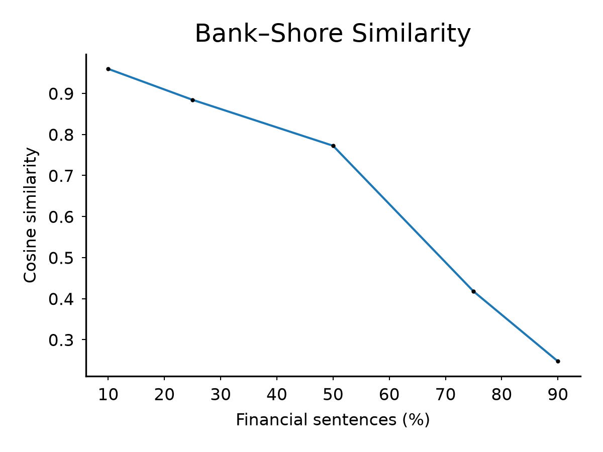
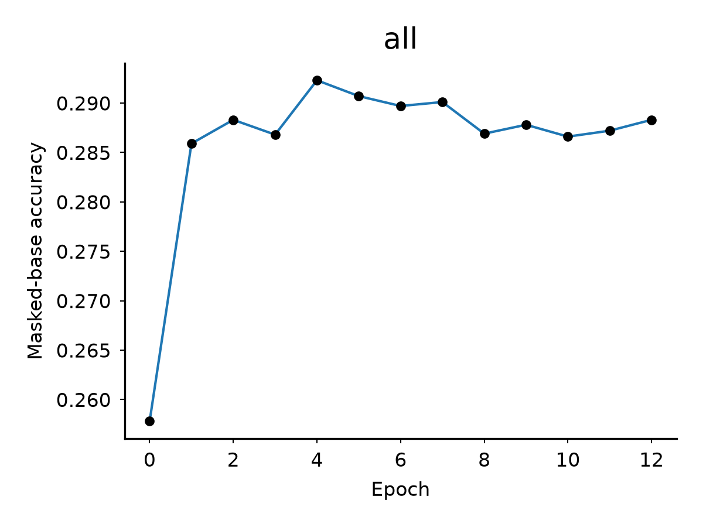
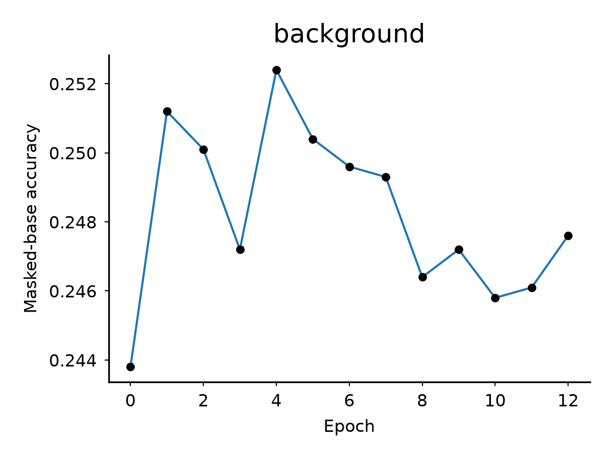
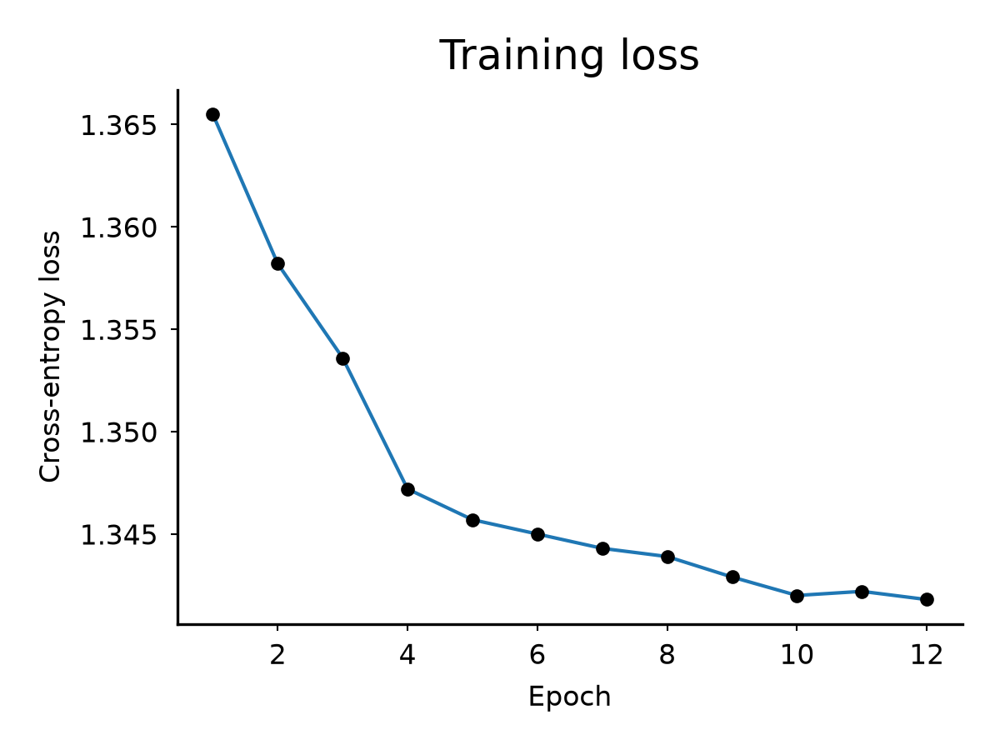
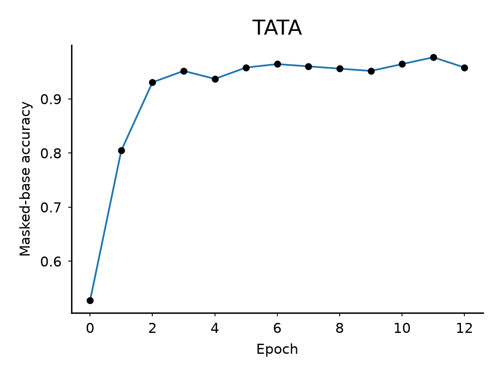
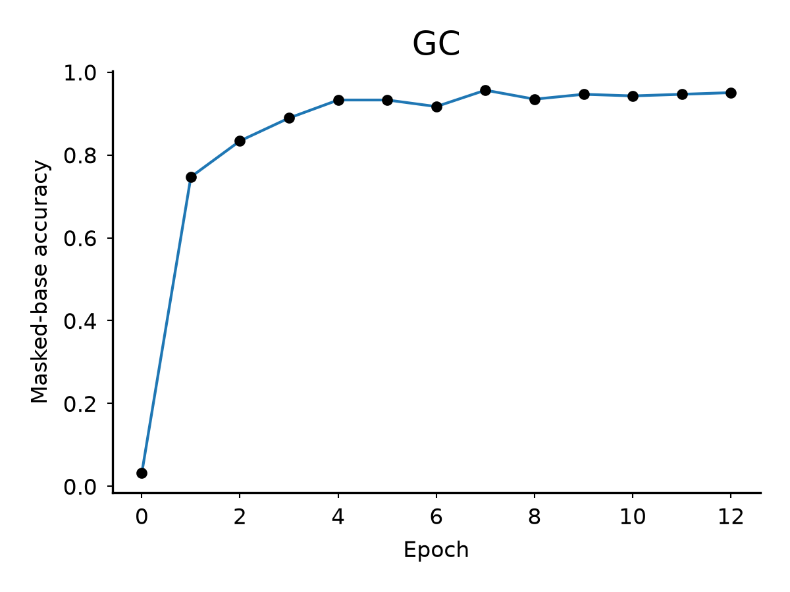
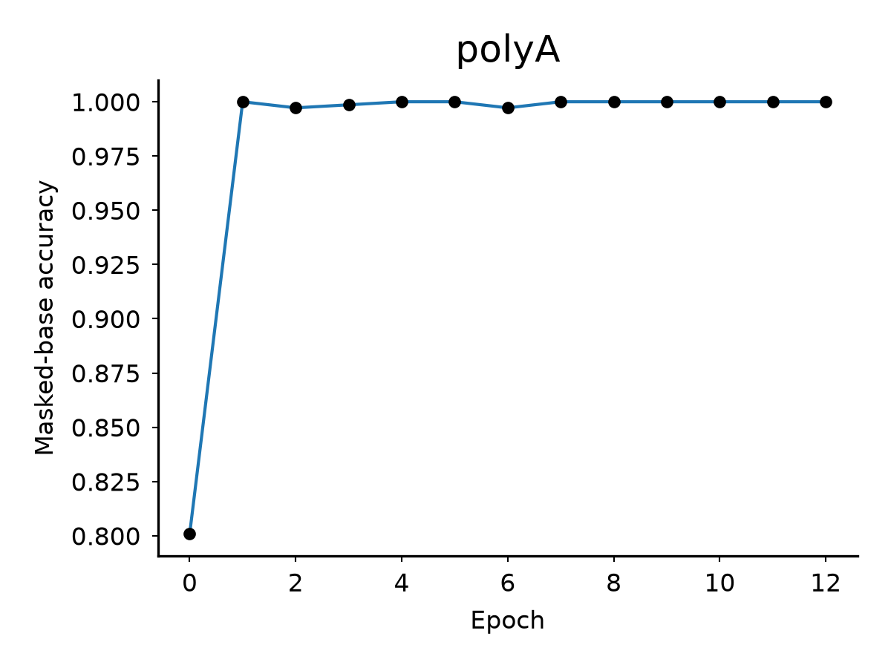
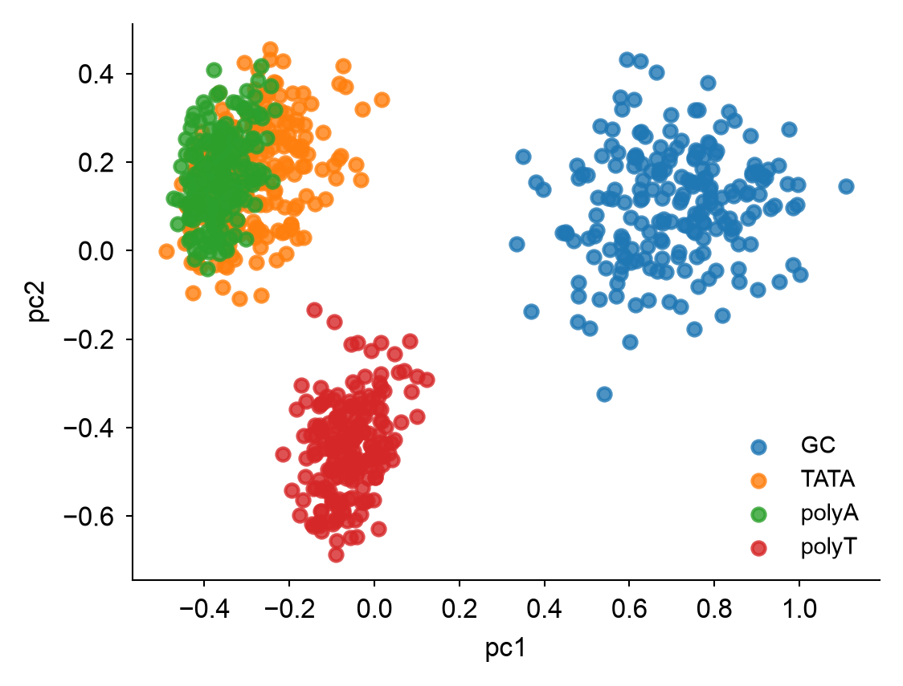
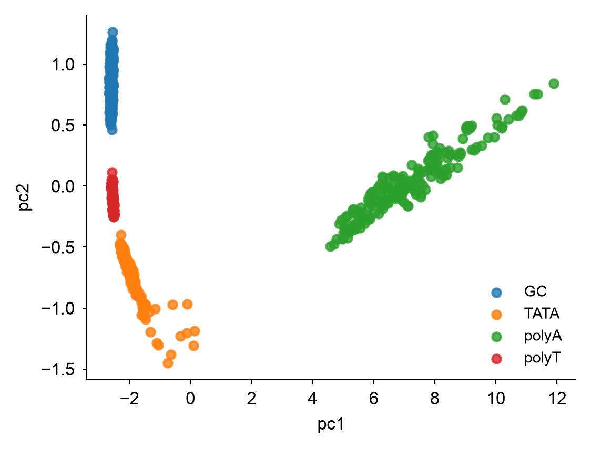
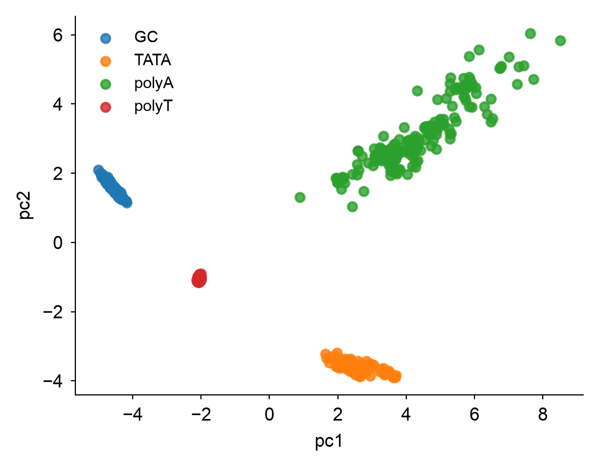

# Masked prediction and contextual embeddings

## Learning goals

After this module you should be able to

1. Explain how masked prediction allows models to learn from sequences without
   externally supplied labels.
2. Describe how convolutional neural networks learn contextual representations
   of DNA sequences.
3. Evaluate whether a model's ability to predict sequence patterns provides
   evidence that those patterns are biologically functional.

## Introduction

Word2vec learns embeddings by training a model to predict surrounding words.
Words that appear in similar contexts can end up with similar embeddings,
allowing models to use what they learn about one word to make predictions about
other words with similar meanings or relationships.

This becomes more complicated when a word has multiple meanings and appears in
different contexts. Since word2vec learns just one embedding for each word,
that embedding is updated based on all the contexts in which the word appears.
For example, `bank` has the same embedding whether it refers to a financial
institution or the side of a river. During training, the embedding is adjusted
based on both contexts, which can pull it away from words associated with
either meaning, such as `account` or `shore`.  As a result, words that are
related in one context may have less similar embeddings, limiting the model's
ability to transfer what it learns between related words. 

To examine this effect, we generated a set of 5,000 sentences that used `bank`
as a financial institution and another set as the side of a river. We then
trained word2vec on datasets of 5,000 sentences containing different
proportions of these two contexts and measured the cosine similarity between
`bank` and `account` or `shore`.

For example, when word2vec was trained on just financial sentences, `bank` and
`account` had a cosine similarity of 0.31. When the training data were changed
to a 75/25 mix of financial and river sentences, their similarity dropped to
0.12.

We also trained models with financial sentences making up 10%, 25%, 50%, 75%,
and 90% of the training data. As the proportion of financial sentences
increased, the similarity between `bank` and `account` increased from -0.25 to
0.21, while its similarity to `shore` decreased from 0.96 to 0.25.

| Bank–Account Similarity | Bank–Shore Similarity |
|-|-|
|  |  |

These results show how different contexts influence a word's embedding. Because
word2vec learns only one embedding per word, the representation must
accommodate both meanings, potentially reducing its similarity to words
associated with either one.

<details>

```
python src/word2vec_train.py \
    --data data/bank_financial.txt \
    --dim 8 \
    --window 2 \
    --epochs 12 \
    --out out/bank_financial
5000 sentences, 32 words, 86000 training pairs
epoch 01 loss=2.6760
epoch 02 loss=2.0417
epoch 03 loss=1.8876
epoch 04 loss=1.8435
epoch 05 loss=1.8303
epoch 06 loss=1.8241
epoch 07 loss=1.8213
epoch 08 loss=1.8195
epoch 09 loss=1.8182
epoch 10 loss=1.8169
epoch 11 loss=1.8167
epoch 12 loss=1.8163
Wrote results to out/bank_financial

cat out/bank_financial/embedding_history.tsv \
| csvgrep -t -c epoch -r "^12$"\
| csvgrep -c word -r "(bank|account)" \
| csvcut -C epoch,word \
| csvformat -T \
| tail -n +2 \
| python src/cosine_similarity.py
0.3137951213590353

(cat data/bank_financial.txt | shuf | head -n 3750 ; 
cat data/bank_river.txt | shuf | head -n 1250) \
| shuf \
> out/bank_mixed_75.txt

python src/word2vec_train.py \
    --data out/bank_mixed_75.txt \
    --dim 8 \
    --window 2 \
    --epochs 12 \
    --out out/bank_mixed_75
5000 sentences, 59 words, 86924 training pairs
epoch 01 loss=3.2241
epoch 02 loss=2.4592
epoch 03 loss=2.2334
epoch 04 loss=2.1396
epoch 05 loss=2.0955
epoch 06 loss=2.0722
epoch 07 loss=2.0580
epoch 08 loss=2.0476
epoch 09 loss=2.0410
epoch 10 loss=2.0362
epoch 11 loss=2.0326
epoch 12 loss=2.0297
Wrote results to out/bank_mixed_75

cat out/bank_mixed_75/embedding_history.tsv \
| csvgrep -t -c epoch -r "^12$"\
| csvgrep -c word -r "(bank|account)" \
| csvcut -C epoch,word \
| csvformat -T \
| tail -n +2 \
| python src/cosine_similarity.py
0.11544264722774267

echo -e "financial_pct\tword\tcosine_similarity" > out/bank_similarity.tsv

for pct in 10 25 50 75 90; do
    financial=$((pct * 50))
    river=$((5000 - financial))

    (shuf -n "$financial" data/bank_financial.txt
     shuf -n "$river" data/bank_river.txt) \
        | shuf > out/bank_mixed_${pct}.txt

    python src/word2vec_train.py \
        --data out/bank_mixed_${pct}.txt \
        --dim 8 \
        --window 2 \
        --epochs 12 \
        --out out/bank_mixed_${pct}

    for word in account shore; do
        similarity=$(
            cat out/bank_mixed_${pct}/embedding_history.tsv \
                | csvgrep -t -c epoch -r "^12$" \
                | csvgrep -c word -r "^(bank|${word})$" \
                | csvcut -C epoch,word \
                | csvformat -T \
                | tail -n +2 \
                | python src/cosine_similarity.py
        )

        printf "%s\t%s\t%s\n" \
            "$pct" "$word" "$similarity" \
            >> out/bank_similarity.tsv
    done
done

cat out/bank_similarity.tsv \
| csvgrep -t -c word -m account \
| csvcut -c financial_pct,cosine_similarity \
| csvformat -T \
| tail -n +2 \
| python src/plot_line.py \
    -o img/bank_account.png \
    --line_style "o-" \
    -x "Financial sentences (%)" \
    -y "Cosine similarity" \
    -t "Bank–Account Similarity"

cat out/bank_similarity.tsv \
| csvgrep -t -c word -m shore \
| csvcut -c financial_pct,cosine_similarity \
| csvformat -T \
| tail -n +2 \
| python src/plot_line.py \
    -o img/bank_shore.png \
    --line_style "o-" \
    -x "Financial sentences (%)" \
    -y "Cosine similarity" \
    -t "Bank–Shore Similarity"
```

</details>

## Contextual embeddings

Contextual embeddings address this limitation by using the surrounding words to
calculate an embedding each time a word appears. Consider two sentences:
- `She deposited money in the bank.`
- `The fisherman sat on the bank of the river.`

In word2vec, `bank` has the same embedding in both sentences because the model
looks up its values in a table. In a contextual model, the surrounding words
are used to calculate a different embedding for each occurrence. Words like
`deposited` and `money` help the model represent `bank` as a financial
institution, while `fisherman` and `river` help it represent the side of a
river.  As a result, the embedding for `bank` can be more similar to `account`
in the first sentence and to `shore` in the second.

Contextual embeddings are particularly important for DNA, where the effect of a
sequence can depend on the surrounding bases. The same DNA sequence might have
different roles depending on where it appears and which other sequence elements
are nearby.

In this module, we will train a model to predict missing bases in DNA sequences
using information from the surrounding bases. The correct answers come directly
from the sequences, making this another example of self-supervised learning. We
will then examine the contextual embeddings the model learns and whether they
capture biologically meaningful patterns.

## Data

We will generate random DNA sequences containing one of three different
patterns inserted at a random position.

| Pattern    | Example    |
|-|-|
| TATA box   | `TATAAA`   |
| GC box     | `GGGCGG`   |
| Poly-A run | `AAAAAAAAAA` |

These patterns occur in real genomes, but their presence alone does not
establish biological function. In our synthetic dataset, none of the patterns
has an assigned biological role. They are simply sequences that occur more
frequently than expected by chance.

The goal is to determine whether a model trained to predict missing DNA bases
can learn these sequence patterns and represent them differently from random
background DNA. We can then examine whether learning predictable patterns tells
us anything about their biological importance.

<details>

```bash
python src/make_genome.py \
    --n 10000 \
    --length 200 \
    --out out/synthetic_genome
wrote out/synthetic_genome: 10000 sequences of 200 bp
  TATA   TATAAA       in 50.2% of sequences
  GC     GGGCGG       in 50.3% of sequences
  polyA  AAAAAAAAAA   in 50.2% of sequences
```

</details>

## Masked prediction

In word2vec, the model was trained to predict surrounding words. Masked
prediction hides part of the input, and the model predicts what was removed.

For example, consider the sequence:

```text
ACGTTATAAAGCT
```
We can replace one of its bases with a mask:

```text
ACGTTAT?AAGCT
```

The model receives the masked sequence and predicts which of the four DNA bases
belongs at the hidden position. Suppose the model made the following
predictions:

| Base | Predicted probability |
|---|---:|
| `A` | 0.82 |
| `C` | 0.05 |
| `G` | 0.04 |
| `T` | 0.09 |

The correct answer is `A`. The model assigned `A` a probability of 0.82, which
is a fairly confident correct prediction. Cross-entropy loss measures how well
the predicted probabilities match the correct answer. Since only one base is
correct, the loss is the negative log of the probability assigned to that base:
$L = -\log(0.82) = 0.20$.

If the model had assigned `A` a probability of 0.05, making it very confident
in an incorrect answer, the loss would have been much larger ($L = -\log(0.05)
= 3.00$). If `A` had been assigned a probability of 0.51, a less confident
correct prediction, the loss would have been $L = -\log(0.51) = 0.67$.

Cross-entropy gives a smaller penalty when the model assigns a higher
probability to the correct answer and a larger penalty when it assigns a lower
probability.

The model then uses backpropagation to calculate gradients for its learned
weights. As in the neural network module, these gradients are used to update
the weights to reduce the training loss. This process is repeated across many
masked positions and sequences, allowing the model to learn which bases are
likely to appear in different sequence contexts.

## Model architecture

The model uses a convolutional neural network to predict masked DNA bases. In
the convolution module, we learned that convolutional filters identify patterns
in nearby positions. By stacking convolutional layers, the model can combine
information from increasingly large regions of the input.

Our model has four parts:

1. Embedding layer. Each DNA base (`A`, `C`, `G`, `T`) and the mask token (`?`)
   is assigned a learned embedding containing 8 numbers.
2. First convolutional layer. Each of the 64 filters calculates a weighted sum
   of the embeddings from 9 neighboring bases centered on the target position,
   adds a bias, and produces one value. Together, the 64 filters produce a
   vector of 64 values at each position.
3. Second convolutional layer. Applies another 64 filters to the output of
   the first layer, combining information from a larger region of the sequence.
4. Output layer. Converts the 64 values at each position into four scores,
   one for each DNA base. Softmax converts these scores into probabilities.


### Embedding layer

The model begins by converting each DNA base into an integer: `A=0`, `C=1`,
`G=2`, `T=3`, and `?=4`.

These integers are used to look up an embedding for each token in a table
containing five rows and eight columns. Each row contains eight learned values,
just like the word embeddings in word2vec.

At this point, every occurrence of `A` has the same embedding, regardless of
its surrounding sequence. The embeddings become contextual only after passing
through the convolutional layers.

### Convolutional layers

The first convolutional layer applies 64 filters with a kernel size of 9. Each
filter combines the embeddings from a window of nine positions to produce one
value. Together, the 64 filters produce a vector of 64 values at every
position.

The second convolutional layer applies another set of 64 filters to these
vectors. Because each position already contains information from its neighbors,
the second layer can combine information from a larger region. With two layers
of kernel size 9, each output position can use information from up to 17
positions in the original sequence.

The model applies a ReLU activation after each convolutional layer.

The resulting 64 values at each position form its contextual embedding. Unlike
the initial embedding lookup, this representation depends on the surrounding
bases. Two occurrences of the same base can therefore have different contextual
embeddings.

### Output layer

The output layer converts the 64-dimensional contextual embedding at each
position into four scores, one for each DNA base.

This is implemented as a convolution with a kernel size of 1, which means it
combines the 64 values at each position without mixing information from
neighboring positions.

Softmax converts the four scores into probabilities for `A`, `C`, `G`, and `T`.

The model produces predictions for every position in the sequence, but only the
masked positions contribute to the training loss.

### Model parameters

Each layer contains weights that are learned during training. We can count
these parameters based on the number of embeddings, filters, and weights in
each layer.
- Embedding layer: 40 parameters, with 5 tokens each having 8 embedding values.
- First convolutional layer: 4,672 parameters, with 64 filters, each having 72
  weights (9 positions × 8 embedding values) and a bias.
- Second convolutional layer: 36,928 parameters, with 64 filters, each having
  576 weights (9 positions × 64 values) and a bias.
- Output layer: 260 parameters, with 4 sets of 64 weights and a bias.

Together, the model has 41,900 learned parameters. All of these are updated
during training to improve predictions of missing DNA bases.

## Pretraining

We train the model to predict missing DNA bases, but predicting bases is not
our ultimate goal. We want the model to learn representations of DNA sequences
that might be useful for other tasks, such as predicting the effects of genetic
variants. Training a model on one task before using it for another is called
pretraining.

We train the model on synthetic DNA sequences, setting aside 10% for
validation. During training, we randomly mask 15% of positions and ask the
model to predict the original bases. The model's parameters are updated using
cross-entropy loss, and after each epoch, we measure masked-base accuracy on
the validation sequences, including accuracy within each inserted pattern.

<details>

```bash
python src/pretrain.py \
    --genome out/synthetic_genome \
    --epochs 12 \
    --log out/pretrain.tsv \
    --out out/pretrain.pt
9000 training and 1000 validation sequences, 41900 parameters
epoch 00 loss=nan masked acc: all=0.258 background=0.244 TATA=0.527 GC=0.032 polyA=0.801  (1s)
epoch 01 loss=1.3655 masked acc: all=0.286 background=0.251 TATA=0.805 GC=0.747 polyA=1.000  (9s)
epoch 02 loss=1.3582 masked acc: all=0.288 background=0.250 TATA=0.931 GC=0.834 polyA=0.997  (18s)
epoch 03 loss=1.3536 masked acc: all=0.287 background=0.247 TATA=0.952 GC=0.889 polyA=0.999  (27s)
epoch 04 loss=1.3472 masked acc: all=0.292 background=0.252 TATA=0.937 GC=0.933 polyA=1.000  (35s)
epoch 05 loss=1.3457 masked acc: all=0.291 background=0.250 TATA=0.958 GC=0.933 polyA=1.000  (44s)
epoch 06 loss=1.3450 masked acc: all=0.290 background=0.250 TATA=0.964 GC=0.917 polyA=0.997  (53s)
epoch 07 loss=1.3443 masked acc: all=0.290 background=0.249 TATA=0.960 GC=0.957 polyA=1.000  (61s)
epoch 08 loss=1.3439 masked acc: all=0.287 background=0.246 TATA=0.956 GC=0.935 polyA=1.000  (70s)
epoch 09 loss=1.3429 masked acc: all=0.288 background=0.247 TATA=0.952 GC=0.947 polyA=1.000  (79s)
epoch 10 loss=1.3420 masked acc: all=0.287 background=0.246 TATA=0.964 GC=0.943 polyA=1.000  (88s)
epoch 11 loss=1.3422 masked acc: all=0.287 background=0.246 TATA=0.977 GC=0.947 polyA=1.000  (97s)
epoch 12 loss=1.3418 masked acc: all=0.288 background=0.248 TATA=0.958 GC=0.951 polyA=1.000  (105s)
wrote out/pretrain.pt

for col in all background TATA GC polyA; do
    cat out/pretrain.tsv \
        | csvcut -t -c epoch,$col \
        | csvformat -T \
        | tail -n +2 \
        | python src/plot_line.py \
            -o img/pretrain_${col}.png \
            --line_style "o-" \
            --point_size 3 \
            -x "Epoch" \
            -y "Masked-base accuracy" \
            -t "$col"
done

cat out/pretrain.tsv \
    | csvcut -t -c epoch,loss \
    | csvformat -T \
    | tail -n +3 \
    | python src/plot_line.py \
        -o img/pretrain_loss.png \
        --line_style "o-" \
        --point_size 3 \
        -x "Epoch" \
        -y "Cross-entropy loss" \
        -t "Training loss"
```

</details>

| Overall accuracy | Background | Training loss |
|---|---|---|
|  |  |  |

| TATA box | GC box | Poly-A run |
|---|---|---|
|  |  |  |

After 12 epochs, accuracy in the random background remained near 25%, as
expected when guessing among four equally likely bases. For the inserted
patterns, the model correctly predicted 95.8% of masked bases in TATA boxes,
95.1% in GC boxes, and 100% in poly-A runs.  The model learned to predict bases
within the inserted sequence patterns more accurately than in the random
background, but better prediction accuracy does not mean the model learned
biological function. 

## Examining contextual embeddings

The ultimate goal of pretraining was to learn contextual embeddings that
capture relationships between DNA sequences. With a trained model, we can
examine these embeddings to see whether sequences containing similar patterns
have similar representations, potentially allowing what the model learns about one sequence
to be applied to others.

To test this, we generated 200 sequences for each of four different patterns.
Each sequence was 17 bases long, matching the receptive field of our
convolutional model, with a pattern inserted near the center and the remaining
bases randomly generated. Three patterns were used during pretraining, while
the fourth was a poly-T run that was not deliberately included in the training
data.

We then passed each sequence through the pretrained model and extracted the
64-dimensional contextual embedding at the center position. We used PCA to
reduce these embeddings to two dimensions and plotted them, coloring each
sequence according to its original group.

<details>

```
python src/make_embedding_sequences.py \
    --n 200 \
    --length 17 \
    --out out/embedding_sequences.tsv

head  out/embedding_sequences.tsv
id	sequence	group
seq0	TCTGCGGGCGGCATAGT	GC
seq1	GTTTTTTTTTTTTACCG	polyT
seq2	ACCAAAAAAAAAACAAG	polyA
seq3	TCTGATATAAACTTATT	TATA
seq4	TTAGTTATAAACTCCGC	TATA
seq5	ACCTTTTTTTTTTTCTG	polyT
seq6	GCGAAAAAAAAAAGTCT	polyA
seq7	GACTTTTTTTTTTTCCT	polyT
seq8	TGACTTATAAATACAAG	TATA

cat out/embedding_sequences.tsv \
    | csvcut -t -c sequence \
    | tail -n +2 \
    | python src/embed.py \
        --model out/pretrain.pt \
> out/contextual_embeddings.tsv

head out/contextual_embeddings.tsv \
| cut -f 1-4
id	e1	e2	e3
seq0	0.000000	0.000000	0.000000
seq1	0.000000	0.000000	0.000000
seq2	0.000000	0.000000	0.000000
seq3	0.000000	0.000000	0.000000
seq4	0.000000	0.000000	0.000000
seq5	0.000000	0.000000	0.000000
seq6	0.000000	0.000000	0.000000
seq7	0.000000	0.000000	0.000000
seq8	0.000000	0.000000	0.000000

python src/pca.py \
    -i out/contextual_embeddings.tsv \
    -o out/contextual_pca.tsv
PC1: 52.9% variance explained
PC2: 27.6% variance explained
Wrote out/contextual_pca.tsv

cat out/embedding_sequences.tsv \
| csvcut -t -c id,group \
| csvformat -T \
> out/embedding_groups.tsv

python src/plot_scatter.py \
    -i out/contextual_pca.tsv \
    -o img/contextual_pca.png \
    --x pc1 \
    --y pc2 \
    --groups out/embedding_groups.tsv

for epochs in 0 1 12; do 
    echo ${epochs}

    python src/pretrain.py \
        --genome out/synthetic_genome \
        --epochs ${epochs} \
        --log out/pretrain_${epochs}.tsv \
        --out out/pretrain_${epochs}.pt

    cat out/embedding_sequences.tsv \
        | csvcut -t -c sequence \
        | tail -n +2 \
        | python src/embed.py \
            --model out/pretrain_${epochs}.pt \
    > out/contextual_embeddings_${epochs}.tsv

    python src/pca.py \
        -i out/contextual_embeddings_${epochs}.tsv \
        -o out/contextual_pca_${epochs}.tsv

    python src/plot_scatter.py \
        -i out/contextual_pca_${epochs}.tsv \
        -o img/contextual_pca_${epochs}.png \
        --x pc1 \
        --y pc2 \
        --groups out/embedding_groups.tsv
done
```
</details>

| Epoch 0 | Epoch 1 | Epoch 12 |
|---|---|---|
|  |  |  |

PCA was fitted separately at each epoch, so we can compare how much the groups
overlap within each plot, but not their absolute positions across plots.

We also used cosine similarity to compare the embeddings of two TATA sequences
and a TATA sequence with a poly-A sequence. We repeated the comparisons using
models trained for 0, 1, and 12 epochs.

| Epoch | TATA–TATA | TATA–poly-A |
|---|---:|---:|
| 0 | 0.849 | 0.593 |
| 1 | 0.961 | 0.550 |
| 12 | 0.994 | 0.560 |

<details>

```bash
tata1_id=$(cat out/embedding_groups.tsv \
    | csvgrep -t -c group -m "TATA" \
    | csvcut -c id \
    | tail -n +2 \
    | head -n 1)

tata2_id=$(cat out/embedding_groups.tsv \
    | csvgrep -t -c group -m "TATA" \
    | csvcut -c id \
    | tail -n +3 \
    | head -n 1)

polya_id=$(cat out/embedding_groups.tsv \
    | csvgrep -t -c group -m "polyA" \
    | csvcut -c id \
    | tail -n +2 \
    | head -n 1)

for epoch in 0 1 12; do
    echo "Epoch $epoch"

    for pair in "${tata1_id}:${polya_id}" "${tata1_id}:${tata2_id}"; do
        id1=${pair%%:*}
        id2=${pair##*:}

        echo -n "  $id1 vs $id2: "

        cat out/contextual_embeddings_${epoch}.tsv \
            | csvgrep -t -c id -r "^(${id1}|${id2})$" \
            | csvcut -C id \
            | csvformat -T \
            | tail -n +2 \
            | python src/cosine_similarity.py
    done
done
Epoch 0
  seq3 vs seq2: 0.5933017683660714
  seq3 vs seq4: 0.8492675571527201
Epoch 1
  seq3 vs seq2: 0.5496573158481899
  seq3 vs seq4: 0.9610958379408593
Epoch 12
  seq3 vs seq2: 0.5598365040724981
  seq3 vs seq4: 0.9942915391223415
```

</details>

## Questions

1. Train models with convolutional kernel sizes of 3, 5, and 9, keeping the
   training data the same. Compare masked-base prediction accuracy in the
   random background and inserted patterns. How does the amount of surrounding
   sequence available to the model affect prediction accuracy? Are some
   patterns more sensitive to context width than others?

2. Compare the PCA plots of contextual embeddings from epochs 0, 1, and 12.
   How well do the four groups separate before and after training? Use cosine
   similarity to compare two sequences containing the same pattern and two
   containing different patterns across these epochs. Do the similarities
   support what you observed in the PCA plots? Would you expect the same result
   from other pairs of sequences, and how could you test that?
