# Unsupervised and self-supervised learning

## Learning goals

After this module you should be able to

1. Explain the difference between supervised, unsupervised, and self-supervised learning.
2. Describe how k-means, PCA, and UMAP identify structure in data without labels.
3. Explain why patterns identified by unsupervised methods do not necessarily
   correspond to meaningful differences in the data.

## Introduction

In the regression and classification modules, we trained models to predict
known outcomes using labeled data. This is called supervised learning, where
each training example has an externally supplied label.

In the word2vec module, the model learned relationships between words by
predicting which words appeared near one another. The model still needed
correct answers during training, but these came directly from the sentences
rather than from externally supplied labels. This is called self-supervised
learning, where training targets are generated from the data itself.

Unsupervised learning takes a different approach by finding structure in data
without predicting known outcomes. Methods such as clustering and
dimensionality reduction identify patterns and relationships between examples
without requiring labels.

In this module, we will examine three unsupervised methods:

1. K-means clustering
2. Principal Component Analysis (PCA)
3. Uniform Manifold Approximation and Projection (UMAP)

## Data

We generate 600 samples split equally into three groups. Each sample has four
numerical features. Each group is assigned a center in the four-dimensional
feature space, and the 200 samples in each group are generated by adding random
noise to that center. The noise is drawn from a normal distribution with a mean
of 0 and a standard deviation of 1. The samples are labeled with their original
groups so we can evaluate the results, but these labels are not used by the
unsupervised methods.

<details>

```bash
python src/make_clusters.py \
    --n 600 \
    --noise 1 \
    --out out/clusters.tsv
wrote 600 samples to out/clusters.tsv

head out/clusters.tsv
id	x1	x2	x3	x4	group
sample0159	-0.1899	-1.1134	0.5796	0.5245	A
sample0261	2.2377	2.1408	-0.5377	0.5426	B
sample0468	-0.6162	-1.1944	1.9355	1.1716	C
sample0428	0.6410	-0.1132	1.9873	3.1266	C
sample0537	-0.3644	0.1274	2.9365	3.7315	C
sample0498	0.2317	0.9652	3.0879	3.3920	C
sample0483	-0.8632	1.2935	1.6499	4.6042	C
sample0387	3.5512	3.3955	-1.5671	-0.7243	B
sample0271	3.1104	2.5917	-1.3981	-1.5436	B
```

</details>

## K-means clustering

Clustering groups samples based on their similarity without knowing which
groups they belong to. One of the simplest approaches is k-means. K-means
begins by placing $k$ cluster centers, called centroids, then repeatedly
assigns each sample to the nearest centroid and moves each centroid to the mean
position of the samples assigned to it. These steps continue until the
assignments stop changing or the centroids move very little.

Unlike the neural networks we trained earlier, k-means does not use gradient
descent or backpropagation. Instead, it alternates between assigning samples to
clusters and updating their centroids to reduce the distances between samples
and their assigned centers.

The goal is to find clusters where samples are as close as possible to their
assigned centroids. K-means measures this using the sum of squared distances
between each sample and its centroid, which it attempts to minimize.

We run k-means with $k=3$, matching the number of groups used to generate the
data.

<details>

```bash
python src/kmeans.py \
    -i out/clusters.tsv \
    -o out/clusters_kmeans.tsv \
    --k 3
600 samples, 4 features, 3 clusters
inertia=2337.4149
Wrote out/clusters_kmeans.tsv

head out/clusters_kmeans.tsv
id	cluster	group
sample0159	0	A
sample0261	2	B
sample0468	1	C
sample0428	1	C
sample0537	1	C
sample0498	1	C
sample0483	1	C
sample0387	2	B
sample0271	2	B
```

</details>

We can compare these assignments with the known groups. If the groups are well
separated in feature space, k-means should recover much of the original
structure. The cluster numbers are arbitrary. Cluster 0 does not necessarily
correspond to group A, and the algorithm has no knowledge of what the groups
represent.

Here, k-means recovered most of the original groups.

| Cluster | Group A | Group B | Group C |
|---:|---:|---:|---:|
| 0 | 192 | 7 | 5 |
| 1 | 7 | 1 | 195 |
| 2 | 1 | 192 | 0 |

<details>

```bash
cat out/clusters_kmeans.tsv \
    | tail -n +2 \
    | cut -f 2,3 \
    | sort \
    | uniq -c

 192 0	A
   7 0	B
   5 0	C
   7 1	A
   1 1	B
 195 1	C
   1 2	A
 192 2	B
```

</details>

K-means correctly assigned 579 of the 600 samples (96.5%). The remaining 21
samples were assigned to clusters dominated by other groups, likely because
their feature values overlapped.

One limitation of k-means is that it requires the number of clusters in
advance. Even if the data contain no distinct groups, k-means will divide the
samples into $k$ clusters.

## Principal component analysis (PCA)

With two-dimensional data, we can plot the samples and look for patterns such
as clusters of points or groups that separate from one another. We can do the
same in three dimensions, but as the number of features increases, visualizing
the data becomes more difficult.

One approach is to plot different pairs of features. Even if we could look at
every possible pair, we would miss patterns that involve combinations of
several features.

| $x_1$ vs $x_2$ | $x_1$ vs $x_3$ | $x_1$ vs $x_4$ | $x_2$ vs $x_3$ |
|---|---|---|---|
| 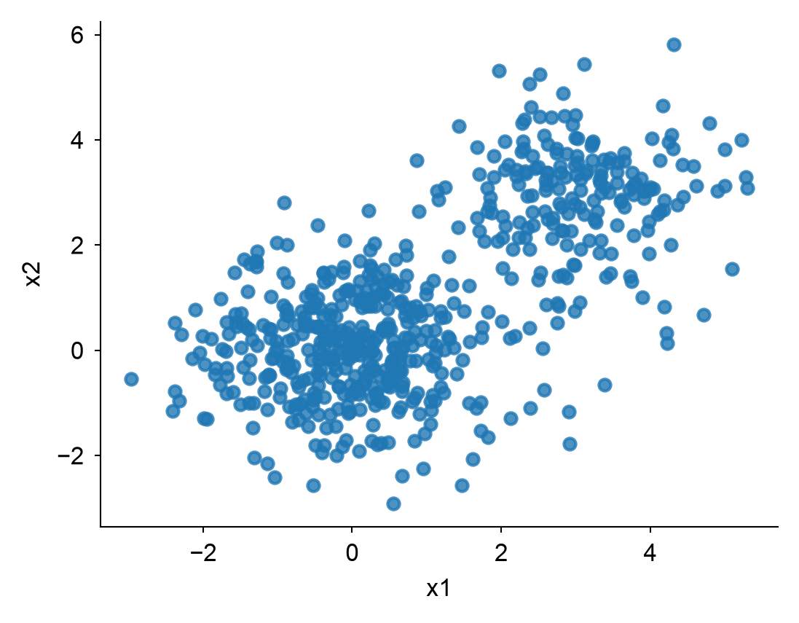 | 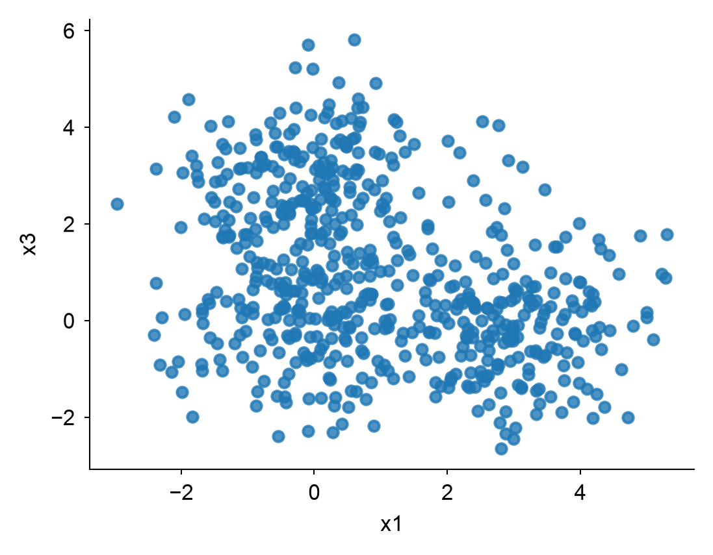 | 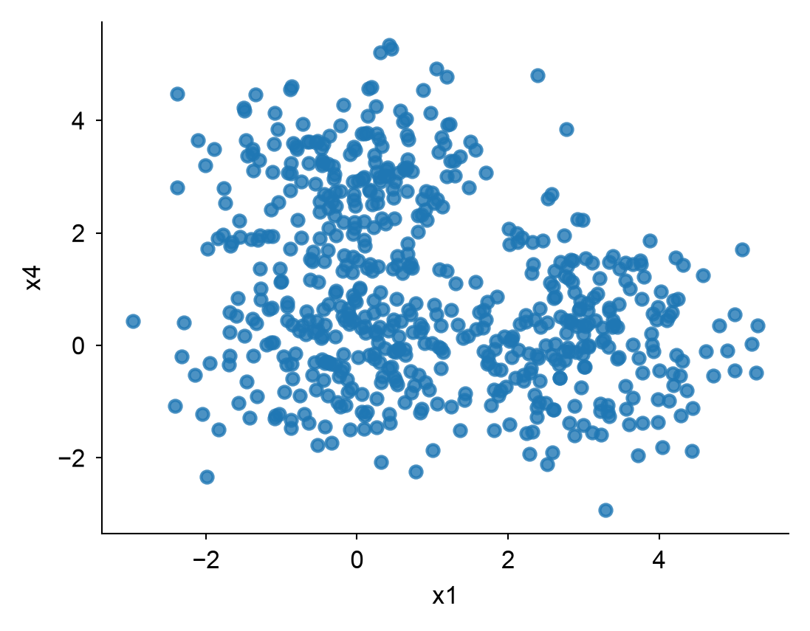 | 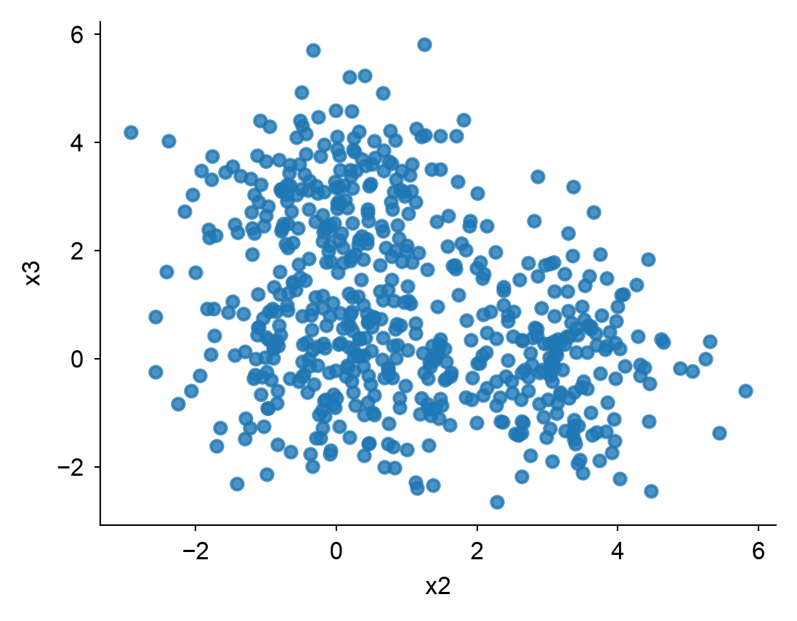 |

<details>

```bash
cat out/clusters.tsv \
    | python src/plot_scatter.py \
        -o img/clusters_x1_x2.png \
        --x x1 \
        --y x2

cat out/clusters.tsv \
    | python src/plot_scatter.py \
        -o img/clusters_x1_x3.png \
        --x x1 \
        --y x3

cat out/clusters.tsv \
    | python src/plot_scatter.py \
        -o img/clusters_x1_x4.png \
        --x x1 \
        --y x4

cat out/clusters.tsv \
    | python src/plot_scatter.py \
        -o img/clusters_x2_x3.png \
        --x x2 \
        --y x3
```

</details>

Principal component analysis (PCA) addresses this problem by finding new axes
that combine the original features. These new axes are called principal
components.

In the regression and neural network modules, we combined input features using
weights. For example, with two features, we can calculate a new value as
$z=w_1x_1+w_2x_2$. This is called a linear combination. Each feature is
multiplied by a weight, and the results are added together to produce a single
number. For a given set of weights, we can calculate $z$ for every sample in a
dataset. Some combinations of weights will produce $z$ values that are similar
across samples, while others will produce a wide range of values. The variance
of these values measures how spread out the samples are along that combination.

| Points | $z=1.0x_1 + 0.0x_2$ Variance=3.68 | $z=0.71x_1 + 0.71x_2$ Variance=1.95 | $z=0.0x_1 + 1.0x_2$ Variance=0.21 |
|---|---|---|---|
| 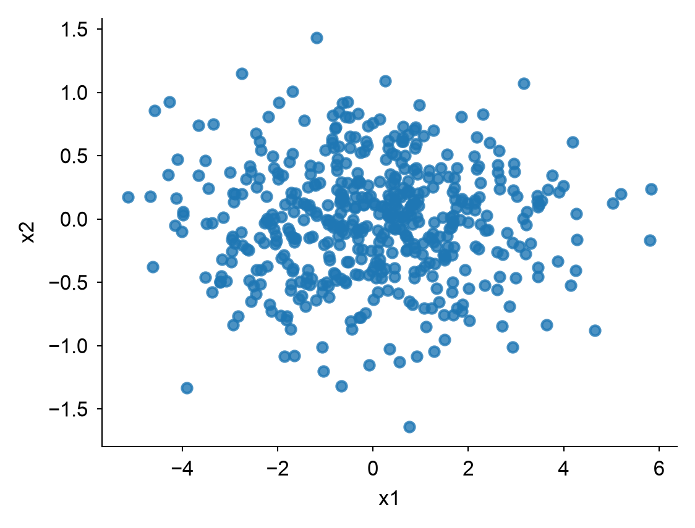 | 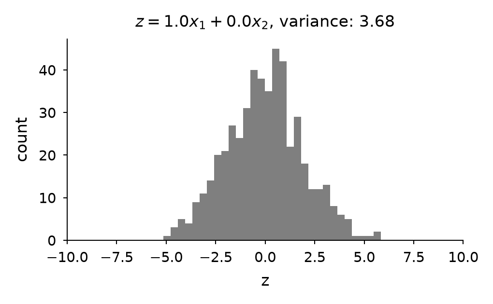 | 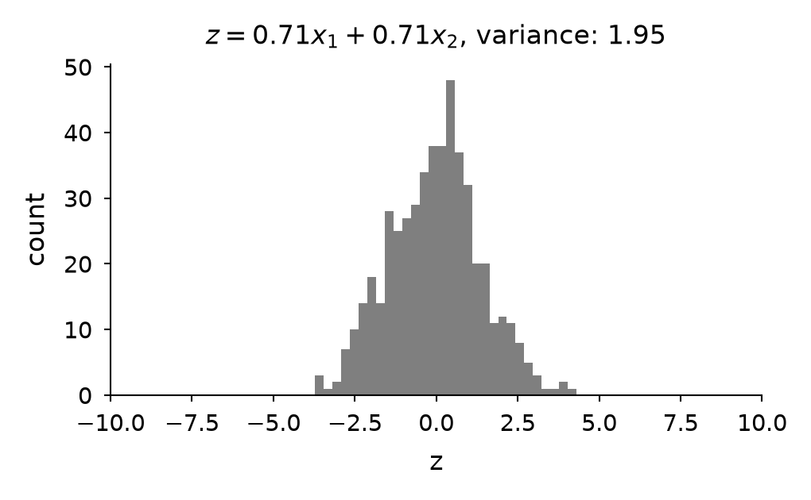 | 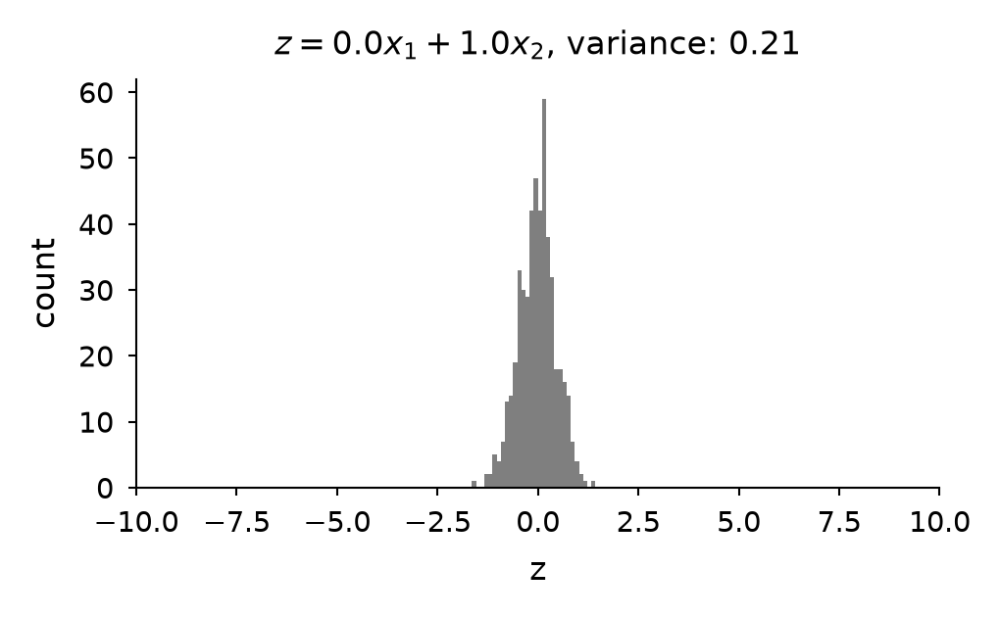 |

<details>

```bash
cat data/football_points.tsv \
    | python src/plot_scatter.py \
        -o img/football_points.png \
        --x x1 \
        --y x2

cat data/football_points.tsv \
    | csvcut -t -c x1,x2 \
    | csvformat -T \
    | tail -n +2 \
    | awk -v w1=1 -v w2=0 '{print w1*$1 + w2*$2;}' \
    | python src/variance.py
3.678521999058195

cat data/football_points.tsv \
    | csvcut -t -c x1,x2 \
    | csvformat -T \
    | tail -n +2 \
    | awk -v w1=1 -v w2=0 '
        BEGIN {print "z"}
        {print w1*$1 + w2*$2}' \
    | python src/plot_hist.py \
        --title "\$z=1.0x_1 + 0.0x_2\$, variance: 3.68" \
        -c z \
        -o img/football_points.1_0.png \
        --xmin -10 \
        --xmax 10

cat data/football_points.tsv \
    | csvcut -t -c x1,x2 \
    | csvformat -T \
    | tail -n +2 \
    | awk -v w1=0.71 -v w2=0.71 '{print w1*$1 + w2*$2;}' \
    | python src/variance.py
1.952239572446618

cat data/football_points.tsv \
    | csvcut -t -c x1,x2 \
    | csvformat -T \
    | tail -n +2 \
    | awk -v w1=0.71 -v w2=0.71 '
        BEGIN {print "z"}
        {print w1*$1 + w2*$2}' \
    | python src/plot_hist.py \
        --title "\$z=0.71x_1 + 0.71x_2\$, variance: 1.95" \
        -c z \
        -o img/football_points.0.71_0.71.png \
        --xmin -10 \
        --xmax 10

cat data/football_points.tsv \
    | csvcut -t -c x1,x2 \
    | csvformat -T \
    | tail -n +2 \
    | awk -v w1=0.0 -v w2=1.0 '{print w1*$1 + w2*$2;}' \
    | python src/variance.py
0.2095907315159936

cat data/football_points.tsv \
    | csvcut -t -c x1,x2 \
    | csvformat -T \
    | tail -n +2 \
    | awk -v w1=0.0 -v w2=1.0 '
        BEGIN {print "z"}
        {print w1*$1 + w2*$2}' \
    | python src/plot_hist.py \
        --title "\$z=0.0x_1 + 1.0x_2\$, variance: 0.21" \
        -c z \
        -o img/football_points.0_1.png \
        --xmin -10 \
        --xmax 10
```

</details>

PCA finds the combination of weights that produces the greatest variance across
the samples, with the constraint that the sum of the squared weights equals
one. This combination defines the first principal component (PC1).

Once PC1 is found, PCA finds a second combination of weights that captures the
greatest remaining variance while being perpendicular to PC1. This process
continues for each additional component.

For our dataset with four features, PCA produces four principal components. We
can use just the first two to represent each sample in two dimensions,
retaining as much variance as possible with two linear components, although
these two components do not necessarily capture a majority of the total
variance.

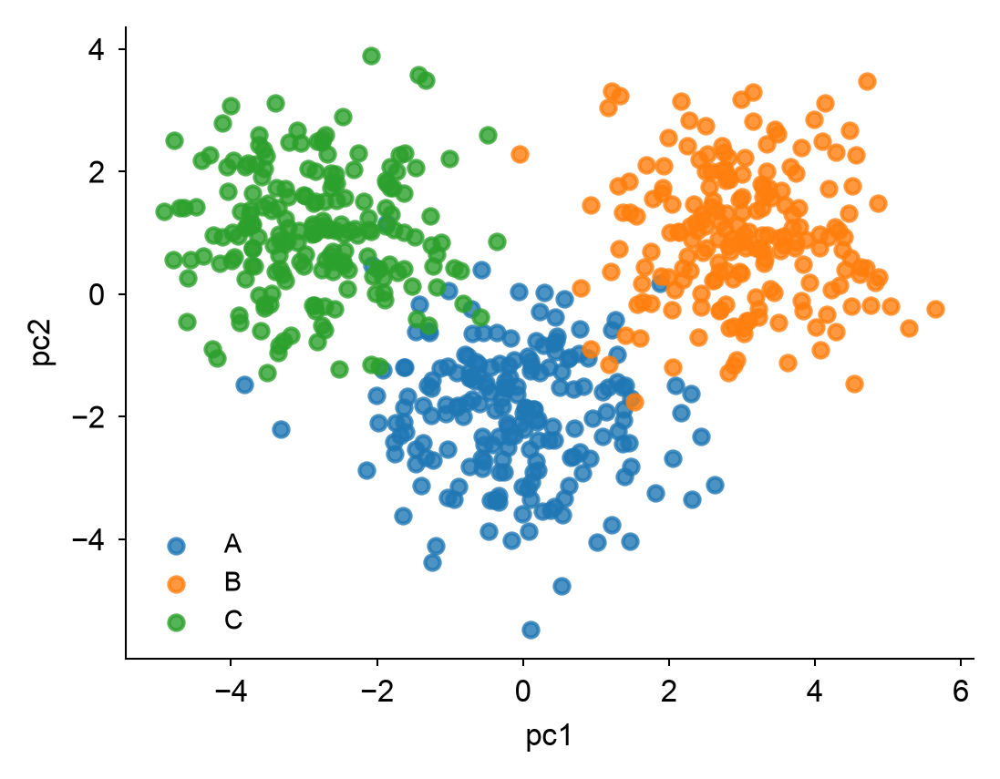

<details>

```bash
csvcut -t -C group out/clusters.tsv \
    | csvformat -T \
    > out/clusters_features.tsv

csvcut -t -c id,group out/clusters.tsv \
    | csvformat -T \
    > out/cluster_groups.tsv

python src/pca.py \
    -i out/clusters_features.tsv \
    -o out/clusters_pca.tsv
PC1: 57.6% variance explained
PC2: 26.1% variance explained
Wrote out/clusters_pca.tsv

python src/plot_scatter.py \
    -i out/clusters_pca.tsv \
    -o img/clusters_pca.png \
    --groups out/cluster_groups.tsv
```

</details>

For our synthetic dataset, PC1 explained 57.6% of the variance and PC2
explained another 26.1%. Together, these two components captured 83.7% of the
variation in the original four-dimensional data.

PCA does not attempt to identify groups or classify samples. If the groups
differ along directions that explain a large amount of variance, they may
separate in the PCA plot. If the differences between groups account for
relatively little variance, PCA may not reveal them.

## UMAP

Uniform Manifold Approximation and Projection (UMAP) is another method for
reducing high-dimensional data to two or three dimensions. UMAP begins by
identifying nearby samples in the original feature space and constructs a
lower-dimensional representation that attempts to preserve these local
relationships.

UMAP first identifies the nearest neighbors of each sample in the original
high-dimensional space. These relationships form a network where samples are
connected to their neighbors, with stronger connections between more similar
samples. UMAP then attempts to reproduce this network in two dimensions by
repeatedly adjusting the positions of the samples. Strongly connected samples
are pulled closer together, while repulsive forces help prevent unrelated
samples from being placed too close together.

Unlike PCA, UMAP does not find new axes that are linear combinations of the
original features. Instead, it finds an arrangement of the samples that
attempts to preserve their local relationships.

Two main parameters guide UMAP's behavior:

- `n_neighbors` controls how many nearby samples are considered when
  constructing the representation. Smaller values emphasize local
  relationships, while larger values incorporate broader structure.
- `min_dist` controls how tightly samples can be packed together in the
  lower-dimensional representation.

| `n_neighbors`=15 `min_dist`=0.1 | `n_neighbors`=30 `min_dist`=0.1 | `n_neighbors`=15 `min_dist`=0.5 |
|---|---|---|
| 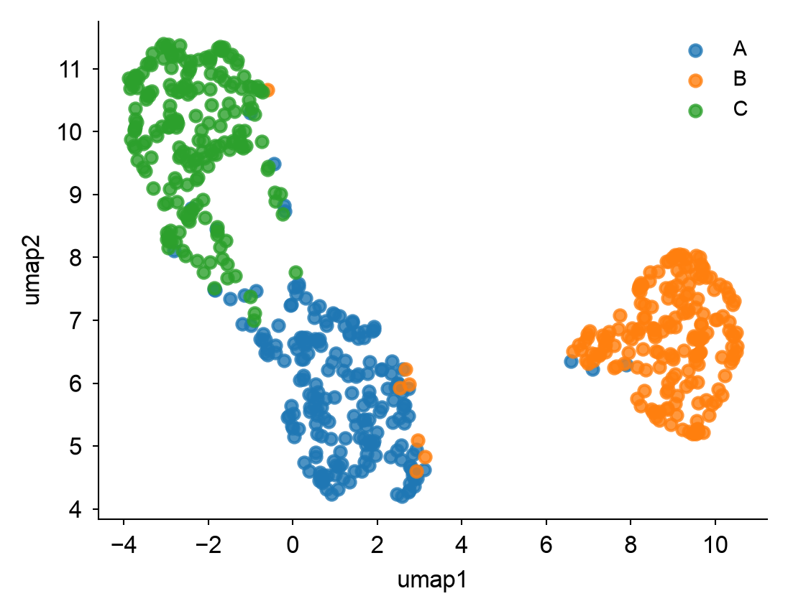 | 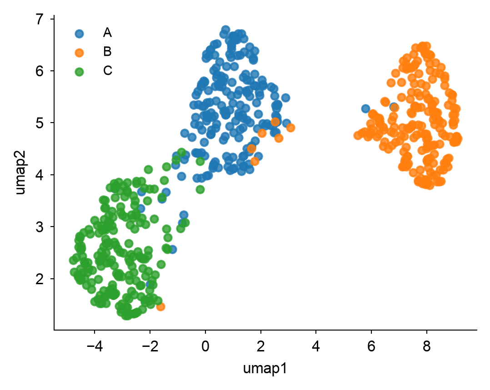 | 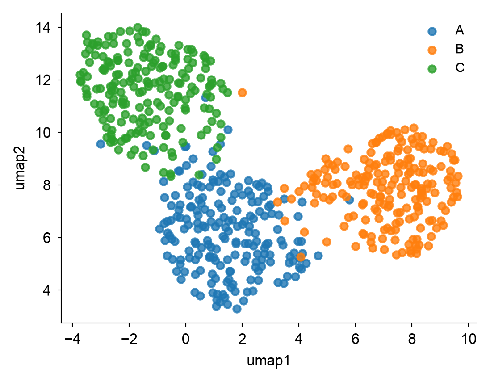 |

<details>

```bash
python src/run_umap.py \
    -i out/clusters_features.tsv \
    -o out/clusters_umap.tsv \
    --n_neighbors 15 \
    --min_dist 0.1

python src/plot_scatter.py \
    -i out/clusters_umap.tsv \
    -o img/clusters_umap.png \
    --x umap1 \
    --y umap2 \
    --groups out/cluster_groups.tsv

python src/run_umap.py \
    -i out/clusters_features.tsv \
    -o out/clusters_umap_n_neighbors_30.tsv \
    --n_neighbors 30 \
    --min_dist 0.1

python src/plot_scatter.py \
    -i out/clusters_umap_n_neighbors_30.tsv \
    -o img/clusters_umap_n_neighbors_30.png \
    --x umap1 \
    --y umap2 \
    --groups out/cluster_groups.tsv

python src/run_umap.py \
    -i out/clusters_features.tsv \
    -o out/clusters_umap.min_dist_0.5.tsv \
    --n_neighbors 15 \
    --min_dist 0.5

python src/plot_scatter.py \
    -i out/clusters_umap.min_dist_0.5.tsv \
    -o img/clusters_umap.min_dist_0.5.png \
    --x umap1 \
    --y umap2 \
    --groups out/cluster_groups.tsv
```

</details>

Distances in a UMAP plot do not necessarily correspond to distances in the
original feature space. Two groups that appear far apart in a UMAP
visualization are not necessarily equally far apart in the original data.

## Batch effect

The synthetic data were designed so that the largest differences between
samples corresponded to the groups we wanted to identify. Real scientific
datasets are not always that simple.

Consider gene expression measurements from two cell types. We might want to
identify differences between the cell types, but the measurements could also be
affected by sequencing depth, experimental batch, or other technical factors.
If technical differences explain more variation than cell type, PCA may
separate samples by batch rather than cell type. K-means may also group samples
according to batch, and UMAP may produce visually distinct clusters that
reflect technical differences.

This does not mean the methods failed. They identified structure in the data,
but that structure was not necessarily the one we wanted to study. By coloring
samples according to known characteristics, such as cell type or experimental
batch, we can sometimes identify what drives the observed patterns.

These methods can identify patterns in data, but determining whether those
patterns are biologically meaningful requires additional evidence.

## Questions

1. Generate datasets with increasing amounts of noise (0.5, 1, and 2). Run
   k-means on each dataset and compare the predicted clusters with the original
   groups. How does increasing the noise affect the number of samples assigned to
   the correct groups? Compare the PCA and UMAP plots for each dataset. How does
   the separation between groups change?

   ```bash
   for noise in 0.5 1 2; do
       python src/make_clusters.py \
           --noise $noise \
           --out out/clusters_${noise}.tsv

       python src/kmeans.py \
           -i out/clusters_${noise}.tsv \
           -o out/clusters_${noise}_kmeans.tsv \
           --k 3

       csvcut -t -C group out/clusters_${noise}.tsv \
           | csvformat -T \
           > out/clusters_${noise}_features.tsv

       csvcut -t -c id,group out/clusters_${noise}.tsv \
           | csvformat -T \
           > out/clusters_${noise}_groups.tsv

       python src/pca.py \
           -i out/clusters_${noise}_features.tsv \
           -o out/clusters_${noise}_pca.tsv

       python src/plot_scatter.py \
           -i out/clusters_${noise}_pca.tsv \
           -o img/clusters_${noise}_pca.png \
           --groups out/clusters_${noise}_groups.tsv

       python src/run_umap.py \
           -i out/clusters_${noise}_features.tsv \
           -o out/clusters_${noise}_umap.tsv

       python src/plot_scatter.py \
           -i out/clusters_${noise}_umap.tsv \
           -o img/clusters_${noise}_umap.png \
           --x umap1 \
           --y umap2 \
           --groups out/clusters_${noise}_groups.tsv
   done
   ```

2. Run UMAP with `n_neighbors` values of 5, 15, and 100, keeping `min_dist`
   fixed at 0.1. Compare the resulting plots. How does the number of neighbors
   affect the size, shape, and separation of the groups? Does changing the
   visualization change the original relationships between samples?

   ```bash
   for n in 5 15 100; do
       python src/run_umap.py \
           -i out/clusters_features.tsv \
           -o out/clusters_umap_${n}.tsv \
           --n_neighbors $n \
           --min_dist 0.1

       python src/plot_scatter.py \
           -i out/clusters_umap_${n}.tsv \
           -o img/clusters_umap_${n}.png \
           --x umap1 \
           --y umap2 \
           --groups out/cluster_groups.tsv
   done
   ```
