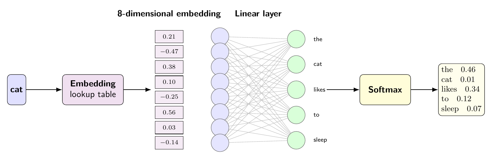
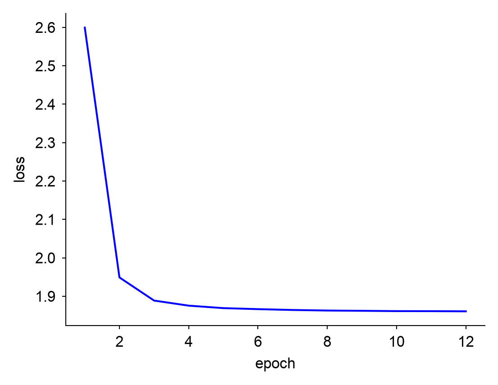
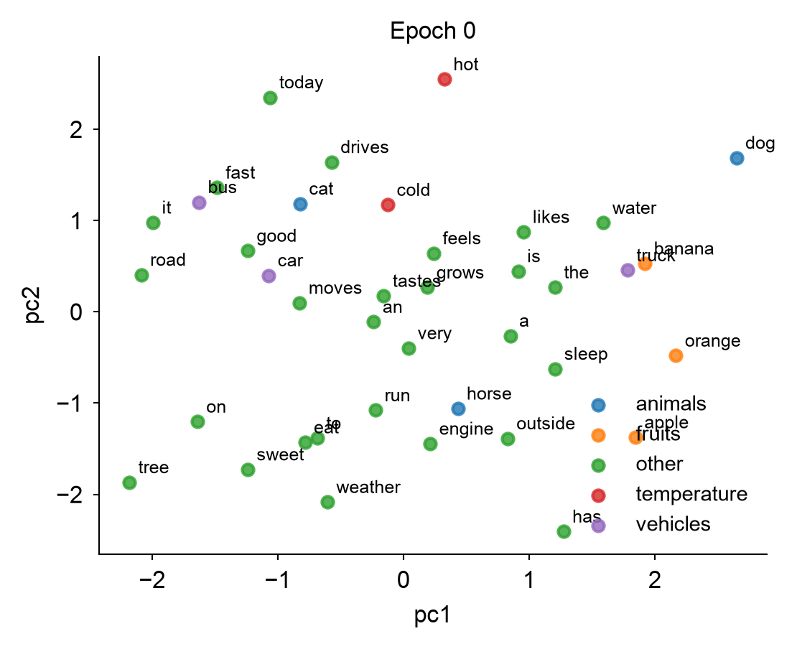
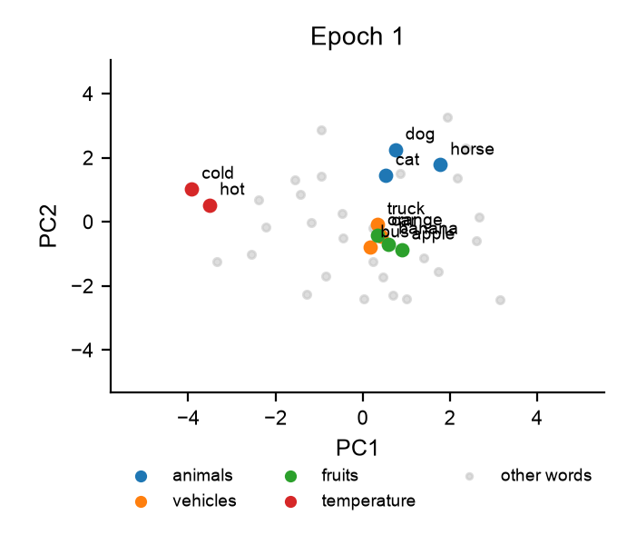
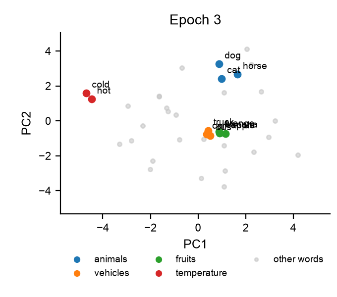
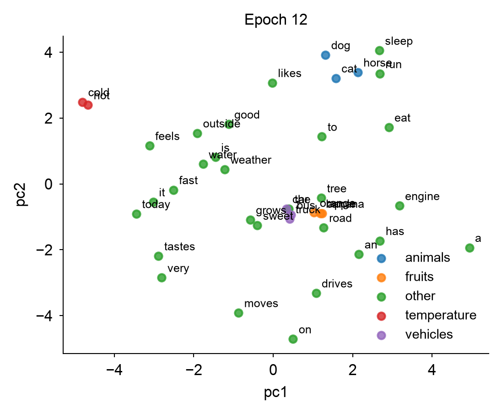

# Embeddings

## Learning goals

After this module you should be able to

1. Explain why one-hot encoding does not represent relationships between words.
2. Describe how predicting neighboring words can train embeddings without
   labels.
3. Interpret distances between learned embeddings and explain what those
   distances do and do not mean.

## Introduction

Machine learning models work with numbers, so inputs like words, images, and
DNA sequences must be represented numerically. One approach is one-hot
encoding, where inputs are represented by binary vectors containing zeros and a
single 1 that corresponds to the input's identity.

For DNA, each base is represented by a four-bit vector where A is `0001`, C is
`0010`, G is `0100`, and T is `1000`. While this encoding satisfies the
numerical input requirement and identifies which base is present, every base is
equally different from every other base, limiting the information the
representation conveys.

For English, with a vocabulary of ~200,000 words, one-hot encoding would
require a vector of 200,000 bits for each word. As with DNA, every word
encoding would be equally different from every other encoding, even though some
words are more closely related. For example, cat and dog are both mammals,
while a car is not. If a model learns that cats sleep, then we would like it to
use that information when making predictions about dogs. If these relationships
were captured in the representation, a model could use what it learns about one
word to make predictions about other, related words.

An alternative to one-hot encoding is an embedding, where objects are still
represented by high-dimensional vectors of numbers (but not 200,000
dimensions). Instead of zeros and a single 1 that uniquely identify each
object, embeddings contain numbers learned during training that can capture
relationships in the data. Objects that appear in similar contexts can end up
with similar embeddings, placing them closer together in the embedding space.

Embeddings can represent most kinds of data, including words, images, and DNA
sequences. We will start by learning embeddings for words using word2vec, a
model that learns by predicting which words appear near one another. We will
start by training it on synthetic sentences with a simple, predictable
structure so we can easily examine what the model learns.

## Data

We generate 10,000 short sentences using templates that place words from the
same group in similar contexts. The model is not given the groups and must
learn these relationships from the sentences.

| Group | Words | Example sentence |
|-|-|-|
| Animals | cat, dog, horse | the cat likes to run |
| Fruits | apple, banana, orange | the apple grows on the tree |
| Vehicles | car, truck, bus | the bus drives on the road |
| Temperature | hot, cold | the weather is very hot |

<details>

```bash
python src/make_sentences.py --n 10000 --out out/synthetic.txt
head -10 out/synthetic.txt
wrote 10000 sentences to out/synthetic.txt
the cat likes to run
the apple grows on a tree
the bus drives on the road
the horse likes to eat
the cat likes to sleep
the car moves very fast
the horse likes to sleep
the weather is very hot
the apple grows on a tree
the weather is very cold
```

</details>

## Word2vec

Word2vec is a method for learning word embeddings by predicting relationships
between words and their surrounding context. It has two architectures:
Continuous Bag of Words (CBOW), which uses surrounding words to predict a
center word, and Skip-gram, which uses a center word to predict its surrounding
words. We will use Skip-gram. For example, consider the sentence:

```text
the cat likes to sleep
```

With a context window of 2, the model uses `cat` to predict the two words
before and after it.

| Input word | Target word |
|-|-|
| `cat` | `the` |
| `cat` | `likes` |
| `cat` | `to` |

Each input-target pair becomes a training example. The model learns by
adjusting its parameters to make the surrounding words more likely.

### Skip-gram model architecture

Skip-gram has two layers:

1. Embedding layer. A lookup table with one row for each word in the
   vocabulary. Each row contains 8 numbers that are initialized randomly and
   then updated during training. When a word is given as input, the numbers
   associated with that word in the table become the input values to the model.
2. Output layer. A fully connected linear layer that takes the 8 embedding
   values and produces a score for every word in the vocabulary. Softmax
   converts these scores into probabilities, representing how likely each word
   is to appear in the context of the input word.

The figure below shows the model for the input word `cat`. The embedding table
contains a vector for each word, and the highlighted row is passed to the
linear layer to predict the surrounding words.



<details>

```bash
tectonic \
    -o img/cartoons \
    img/cartoons/word2vec_model.tex

pdftoppm \
    -png \
    -r 150 \
    -singlefile \
    img/cartoons/word2vec_model.pdf \
    img/cartoons/word2vec_model
```

</details>

For each training example, the model takes a center word and predicts a
surrounding word. It then calculates the cross-entropy loss between the
predicted probabilities and the actual surrounding word and uses gradient
descent to update the weights in both layers.

As training progresses, words that appear in similar contexts tend to receive
similar updates. This can cause their embeddings to move closer together, even
though the model was never told which words are related.

Consider the training pair `cat` → `the`. The model takes `cat` as input and
looks up its 8-dimensional embedding. These eight numbers are passed through
the linear layer, which produces a score for each word in the vocabulary.
Softmax converts the scores into probabilities.

In the example above, the model assigns a probability of $0.46$ to `the`. Since
`the` is the correct answer, the model should assign it a probability as close
to 1 as possible. The model uses cross-entropy loss, which for a single correct
word is:

$$L = -\log P(\text{the}\mid\text{cat})$$

For our prediction:

$$L = -\log(0.46) = 0.78$$

The model uses gradient descent to update the weights in the linear layer and
the embedding for `cat` to reduce this loss. For the next training pair, 
`cat`/`likes`, the model repeats the process with a different target word.

After training on many pairs, the embedding for `cat` will be adjusted to help
predict the words that commonly appear around it. Because `dog` and `horse`
appear in similar contexts, their embeddings can become similar to the
embedding for `cat`, even though the model was never told that these words are
related.

### Training

The model was trained on the 10,000 synthetic sentences generated earlier. Each
sentence was converted into center-context word pairs using a context window of
two. The model was trained for 12 epochs, updating the embedding table and
linear layer to reduce the prediction loss.



The training loss decreased from 2.60 after the first epoch to 1.86 after 12
epochs, with most of the improvement occurring during the first three epochs.
The model became better at predicting surrounding words, but the loss alone
does not tell us whether the embeddings captured the relationships between
words.

<details>

```bash
python src/word2vec_train.py \
    --data out/synthetic.txt \
    --dim 8 \
    --window 2 \
    --epochs 12 \
    --out out/synthetic
10000 sentences, 39 words, 146360 training pairs
epoch 01 loss=2.5994
epoch 02 loss=1.9489
epoch 03 loss=1.8886
epoch 04 loss=1.8754
epoch 05 loss=1.8690
epoch 06 loss=1.8663
epoch 07 loss=1.8641
epoch 08 loss=1.8627
epoch 09 loss=1.8620
epoch 10 loss=1.8612
epoch 11 loss=1.8611
epoch 12 loss=1.8607
Wrote results to out/synthetic

python src/plot_word2vec_training.py \
    -i out/synthetic/training_loss.tsv \
    -o img/word2vec_loss.png \
    --columns loss

for epoch in 0 1 3 12; do
    cat out/synthetic/embedding_history.tsv \
    | csvgrep -t -c epoch -r "^${epoch}$" \
        | csvcut -C epoch \
        | csvformat -T \
        > out/synthetic/epoch_${epoch}.tsv
     python src/pca.py \
        -i out/synthetic/epoch_${epoch}.tsv \
        -o out/synthetic/epoch_${epoch}_pca.tsv
done
PC1: 20.3% variance explained
PC2: 19.5% variance explained
Wrote out/synthetic/epoch_0_pca.tsv
PC1: 22.5% variance explained
PC2: 17.2% variance explained
Wrote out/synthetic/epoch_1_pca.tsv
PC1: 21.1% variance explained
PC2: 17.8% variance explained
Wrote out/synthetic/epoch_3_pca.tsv
PC1: 20.1% variance explained
PC2: 18.5% variance explained
Wrote out/synthetic/epoch_12_pca.tsv

for epoch in 0 1 3 12; do
    python src/plot_scatter.py \
        -i out/synthetic/epoch_${epoch}_pca.tsv \
        -o img/word2vec_epoch_$(printf "%03d" "$epoch").png \
        --groups data/word2vec_groups.tsv \
        --labels \
        --title "Epoch ${epoch}"
done
```


</details>

The model was trained to predict surrounding words, but the goal was to learn
representations that captured relationships between words. We can examine these
representations to see whether words that appeared in similar contexts ended up
with similar embeddings.

Each embedding has 8 dimensions, making it difficult to visualize directly.
Principal component analysis (PCA) finds the directions along which the
embeddings vary the most. We use the first two principal components to
visualize the embeddings in two dimensions.

The figures below show the embeddings before training and after 12 epochs.
Words are colored by their groups, but these labels were not used during
training. 

| Epoch 0 | Epoch 1 |
|---|---|
|  |  |

| Epoch 3 | Epoch 12 |
|---|---|
|  |  |


### Measuring similarity

While PCA is useful for visualizing embeddings, words that appear close
together in the PCA plot are not necessarily the closest words in the original
embedding space. We can measure similarity using cosine similarity, which
compares the direction of two vectors.

$$
S(a,b) = \frac{a \cdot b}{\|a\|\|b\|}
$$

Cosine similarity ranges from -1 to 1, where 1 indicates vectors pointing in
the same direction, 0 indicates perpendicular vectors, and -1 indicates
opposite directions.

By calculating the cosine similarity between each pair of word embeddings, we
can identify the nearest neighbors of a word without reducing the dimensions.

We compared the cosine similarity of several word pairs before training (epoch
0) and after training (epoch 12).

| Word 1 | Word 2 | Epoch 0 | Epoch 12 |
|-|-|-|-|
| cat | dog | -0.277 | 0.862 |
| cat | car | 0.661 | 0.388 |
| dog | horse | -0.072 | 0.930 |
| car | truck | 0.045 | 0.994 |
| apple | banana | 0.500 | 0.999 |
| hot | cold | 0.353 | 0.999 |

Before training, the embeddings were randomly initialized, so their
similarities did not reflect the relationships between words. After training,
words from the same group had much higher similarities. The similarity between
`cat` and `dog` increased from -0.277 to 0.862, while the similarity between
`cat` and `car` decreased from 0.661 to 0.388.

The model learned the relationships built into the synthetic data. However,
high similarity does not necessarily mean that the embeddings capture
relationships useful for other prediction tasks.  The model also learned that
`hot` and `cold` were nearly identical, with a cosine similarity of 1.000.
Although these words have opposite meanings, they appeared in the same contexts
in the training data. This shows that word2vec learned relationships based on
how words were used, not necessarily what they meant.

<details>

```bash
cat out/synthetic/embedding_history.tsv \
| csvgrep -t -c epoch -r "^0$" \
| csvgrep -c word -r "(cat|dog)" \
| csvformat -T 
epoch	word	dim0	dim1	dim2	dim3	dim4	dim5	dim6	dim7
0	cat	-0.91382301	-0.65813726	0.07802387	0.52580875	-0.48799172	1.19136918	-0.81400764	-0.73599285
0	dog	1.44513369	0.85641259	2.21807575	0.52316552	0.34664667	-0.19733144	-1.05458987	1.27799511

cat out/synthetic/embedding_history.tsv \
| csvgrep -t -c epoch -r "^0$" \
| csvgrep -c word -r "(cat|dog)" \
| csvcut -C epoch,word \
| csvformat -T \
| tail -n +2 \
| python src/cosine_similarity.py
-0.2769544683856346

cat out/synthetic/embedding_history.tsv \
| csvgrep -t -c epoch -r "^12$" \
| csvgrep -c word -r "(cat|dog)" \
| csvcut -C epoch,word \
| csvformat -T \
| tail -n +2 \
| python src/cosine_similarity.py
0.8615560805008214

pairs=("(cat|dog)" "(cat|car)" "(dog|horse)" "(car|truck)" "(apple|banana)" "(hot|cold)")

for pair in "${pairs[@]}"; do
    for epoch in 0 12; do
        echo "$pair $epoch"
        cat out/synthetic/embedding_history.tsv \
        | csvgrep -t -c epoch -r "^${epoch}$" \
        | csvgrep -c word -r "${pair}" \
        | csvcut -C epoch,word \
        | csvformat -T \
        | tail -n +2 \
        | python src/cosine_similarity.py
    done
done

(cat|dog) 0
-0.2769544683856346
(cat|dog) 12
0.8615560805008214
(cat|car) 0
0.6610007901279926
(cat|car) 12
0.3881260948936069
(dog|horse) 0
-0.07198597946278765
(dog|horse) 12
0.929570110073506
(car|truck) 0
0.04464849101063426
(car|truck) 12
0.9935776941080343
(apple|banana) 0
0.5003754227917153
(apple|banana) 12
0.9994311803968079
(hot|cold) 0
0.35260334442931124
(hot|cold) 12
0.9998219670637737
```

</details>

## Questions

1. Train the model with 100, 1,000, and 10,000 synthetic sentences. Compare the
   training loss and final embeddings. How much data does the model need before
   words from the same group begin to cluster?

   ```bash
   for n in 100 1000 10000; do
       python src/make_sentences.py \
           --n $n \
           --out out/synthetic_${n}.txt

       python src/word2vec_train.py \
           --data out/synthetic_${n}.txt \
           --dim 8 \
           --epochs 12 \
           --out out/synthetic_${n}
   done
   ```

2. Train the model with embedding dimensions of 2, 8, and 32, keeping the
   training data the same. Compare the training loss and the distances between
   words from the same group. Does increasing the number of dimensions always
   produce better embeddings?

   ```bash
   for dim in 2 8 32; do
       python src/word2vec_train.py \
           --data out/synthetic.txt \
           --dim $dim \
           --epochs 12 \
           --out out/dim_${dim}
   done
   ```
