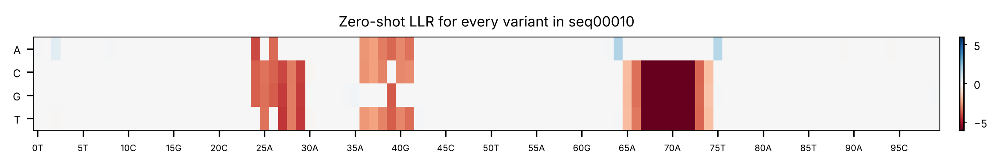
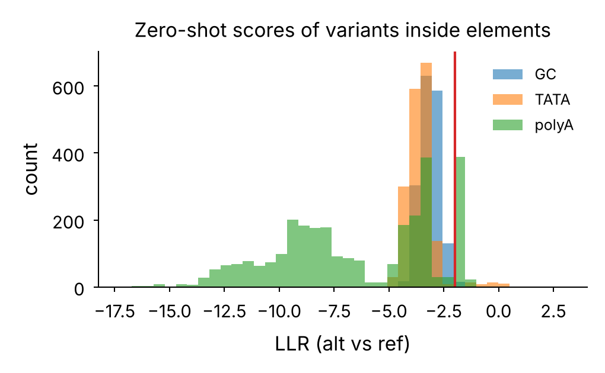

# Zero-shot variant scoring

## Learning goals

After this module you should be able to

1. Score a variant with a pretrained model and no labels, using a
   log-likelihood ratio.
2. Explain why an unexpected variant is not necessarily a damaging one.
3. Identify where zero-shot scores are likely to mislead.

## Introduction

A model pretrained to fill in hidden bases can score variants without ever
being trained on variant labels. Hide the position, ask the model how likely
each base is there given the rest of the sequence, and compare the alternate
base to the reference.

$$\text{LLR} = \log P(\text{alt} \mid \text{context}) - \log P(\text{ref} \mid \text{context})$$

A negative log-likelihood ratio (LLR) means the model finds the alternate base
less expected than the reference. An LLR of $-3$ means it thinks the alternate
base is $e^3 \approx 20$ times less likely.

ESM-1v (Meier et al. 2021) scores protein variants this way, and GPN (Benegas
et al. 2023) scores DNA variants this way. The reasoning is that evolution
removes damaging variants, so sequences that survive contain few of them, and
a model that learns what surviving sequences look like will find damaging
variants unexpected.

That reasoning has a gap. A variant can be unexpected for reasons that have
nothing to do with function.

## Data

We score variants in 200 new sequences generated the same way as the
pretraining data. Because we generated them, we know each variant's true effect
on expression.

$$\text{expression} = 1 + 2 \times (\texttt{TATAAA} \text{ present}) + 1 \times (\texttt{GGGCGG} \text{ present})$$

A variant that breaks the only TATA box lowers expression by 2. A variant that
breaks the GC box lowers it by 1. A variant in a poly-A run does nothing.

<details>

```bash
python src/make_genome.py \
    --n 200 \
    --seed 1 \
    --out out/heldout.tsv
wrote out/heldout.tsv: 200 sequences of 100 bp
  TATA   TATAAA       in 49.5% of sequences
  GC     GGGCGG       in 47.0% of sequences
  polyA  AAAAAAAAAA   in 48.5% of sequences
```

</details>

## One sequence

Sequence `seq00010` has all three elements, a TATA box at position 24, a GC box
at 36, and a poly-A run at 65. Here is the LLR for every possible variant,
arranged like the in silico mutagenesis maps from week 2.



The model flags variants in all three elements and almost nothing in
background. The darkest block is the poly-A run.

<details>

```bash
python src/zero_shot.py \
    --model out/pretrained.pt \
    --genome out/heldout.tsv \
    --index 10 \
    -o out/zs.seq10
seq00010 elements: TATA:24,GC:36,polyA:65
scored 300 variants in 1 sequences

python src/plot_matrix.py \
    -i out/zs.seq10.matrix.tsv \
    --row_labels \
    --col_labels \
    --every_col 5 \
    --vmin -6 \
    --vmax 6 \
    --colorbar \
    --width 8 \
    --height 1.4 \
    --title "Zero-shot LLR for every variant in seq00010" \
    -o img/zs.seq10.png
```

</details>

## Every sequence

Across all 60,000 variants in the 200 sequences

| Region | Variants | Mean LLR | Mean true effect | LLR below $-2$ |
|-|-|-|-|-|
| TATA       | 1,782  | -3.55 | -1.92 | 97.4% |
| GC         | 1,692  | -3.11 | -0.97 | 99.0% |
| poly-A     | 2,910  | -6.50 | 0.01  | 86.3% |
| background | 53,616 | -0.01 | 0.00  | 0.7%  |



By the usual summary, zero-shot scoring works well. Ranking variants by LLR
finds the ones that lower expression with an AUC of 0.958, and no labels were
used.

Now look at the variants the model calls most damaging. Of the 6,299 variants
with an LLR below $-2$, only 55.4% actually lower expression, and 39.9% are in
poly-A runs. The poly-A variants get the most extreme scores of all, about
twice as negative as the TATA box variants, because the poly-A run is longer
and more predictable. If you used these scores to choose variants to test in
the lab, the top of your list would be variants that do nothing.

The model did what it was trained to do. It learned which sequences are common,
and a variant in a poly-A run breaks the most common pattern in the data. What
it was never trained to know is which patterns matter for expression.

<details>

```bash
python src/zero_shot.py \
    --model out/pretrained.pt \
    --genome out/heldout.tsv \
    --all \
    -o out/zs.all
scored 60000 variants in 200 sequences

python src/summarize_llr.py \
    -i out/zs.all.tsv \
    --threshold -2
region           n  mean LLR  mean true effect  frac LLR < -2.0
TATA          1782     -3.55             -1.92            0.974
GC            1692     -3.11             -0.97            0.990
polyA         2910     -6.50              0.01            0.863
background   53616     -0.01             -0.00            0.007
AUC of -LLR for finding variants that lower expression: 0.958
variants with LLR < -2.0: 6299, of which 55.4% lower expression (39.9% are in poly-A runs)

awk -F'\t' 'NR==1 || $5!="background"' out/zs.all.tsv \
> out/zs.elements.tsv

python src/plot_hist.py \
    -i out/zs.elements.tsv \
    -c llr \
    --group region \
    --bins 40 \
    --vline -2 \
    --xlabel "LLR (alt vs ref)" \
    --title "Zero-shot scores of variants inside elements" \
    -o img/zs.hist.png
```

</details>

## Where this happens in real genomes

Real genomes are full of sequence that is common for reasons other than
function. Repeats and transposable elements make up about half of the human
genome. Low-complexity sequence, like poly-A tracts and microsatellites, is
easy to predict and easy to mutate. Mutation rates vary with sequence context,
so some bases are rare simply because they mutate away often. A model trained
to predict sequence learns all of this along with the functional elements.

Benegas et al. (2023) addressed part of this when building GPN by giving
repeats less weight during training. That is a design decision about what the
model should treat as signal. When you read about a zero-shot predictor, look
for decisions like this one and ask what common but non-functional patterns the
training data contains.

The comparison also depends on the benchmark. Most of the 60,000 variants are
in background, where both the model and the truth say nothing happens. Those
easy variants pull the AUC up. Restricting the evaluation to variants inside
elements, the variants a researcher would actually be choosing between, tells
a different story.


## Exercise

Pick a variant with a strongly negative LLR. Write one sentence saying exactly
what the score measures. Then list the evidence you would need before calling
the variant damaging to expression, and the further evidence you would need
before calling it pathogenic in a patient. The LLR is evidence for neither
claim by itself.

# Questions

1. Compute the AUC using only variants inside elements. How does it compare to
   0.958? Which number better describes how useful the scores are?

   ```bash
   python3 -c "
   import numpy as np
   d = np.genfromtxt('out/zs.elements.tsv', names=True, dtype=None, encoding=None, delimiter='\t')
   y, s = (d['true_effect'] < 0).astype(int), -d['llr']
   pos, neg = s[y == 1], s[y == 0]
   print(np.mean(pos[:, None] > neg[None, :]))
   "
   ```

2. Pretrain a new model on sequences without poly-A runs and score the same
   held-out variants. Does it still flag variants in poly-A runs? Why or why
   not?

   ```bash
   python src/make_genome.py --n 20000 --elements TATA,GC --out out/genome_noA.tsv
   python src/pretrain.py --genome out/genome_noA.tsv --epochs 10 --out out/pretrained_noA.pt
   python src/zero_shot.py --model out/pretrained_noA.pt --genome out/heldout.tsv --all -o out/zs.noA
   python src/summarize_llr.py -i out/zs.noA.tsv --threshold -2
   ```

3. Lower `--p_element` to 0.05 so each element appears in only 5% of the
   pretraining sequences, pretrain, and score the held-out variants. Does the
   model still learn the elements? What does this suggest about zero-shot
   scores for rare but important elements?

4. ESM-1v scores protein variants by the same LLR. What would be the protein
   equivalent of a poly-A run, a pattern that is common but not tied to the
   function you care about?

## Reading

- Meier et al. 2021. Language models enable zero-shot prediction of the effects of mutations on protein function. *NeurIPS 2021*. ESM-1v, variant effects with no labels.
- Benegas, Batra and Song 2023. DNA language models are powerful predictors of genome-wide variant effects. *PNAS* 120:e2311219120. GPN, self-supervised pretraining on plant genomes.
